The goal of this tutorial is to describe, step by step, how to build the hydraulic part of a sprinkler system.

Use this tutorial as a guideline to design your own. All components (brand, size, quantity, capacity...)
described below are my own design, as an example, but each project is different. At the end of this tutorial, you will be
able to use the sprinkler manually.

- [Water inflow level](#water-inflow-level)
- [Zones definition](#zones-definition)
- [Network definition](#network-definition)
- [Installation](#installation)
    - [Dig trenches and set main pipe](#dig-trenches-and-set-main-pipe) 
    - [Valve boxes](#valve-boxes)
    - [Water main supply](#water-main-supply)
    - [Valves](#valves) 
    - [Connections](#connections)
- [Drop by Drop](#drop-by-drop)
- [Result test](#result-test)
    
**Useful conversion Inch/Metric**:
1⁄2" = 15/21
3⁄4" = 20/27
1" = 26/34
1⁄4" = 33/42
{: .notice--info}
      
## Water inflow level

### Define system capacity

The Hunter tutorial below helped me:
[Hunter tutorial](https://www.hunterindustries.com/residential-system-design-guide)

### Check pressure level

Check the pressure with a manometer to determine the pipe size and the number of rotors per zone.

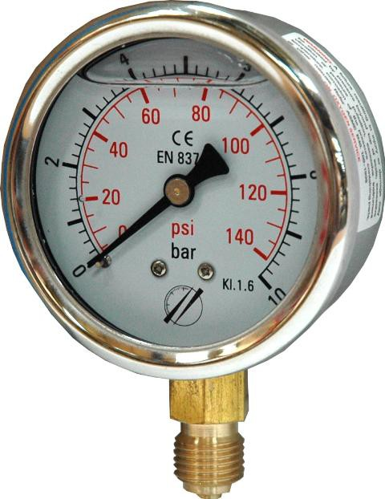{:height="48px" width="96px"} 
{: .text-center}

Here are my results as an example:

- Static pressure: 3.5 Bars 50 PSI
- Water meter: 1"
- Service line: 1"
- Design capacity: 53 l/min 14GPM -> 3,18 m3/h
- Working pressure: 2 Bars 29 PSI
{: .notice--success}

According to the rotor Rainbird 3500 specification:
- Nozzle standard 2; 8.2m radius; 0.47m3/h

So, with my design capacity of 3.18 m3/h, 3.18/0.47 = 6.76, so I can use 6 rotors maximum per zone.

Note: The pressure decreases by 0.25 Bar every 10m for a 25mm pipe. So you have to take it into consideration
when you calculate the capacity of distant zones from your manometer reading.
{: .notice--info}

My biggest zone is a square of 76 m2, with 4 rotors of 8.2m radius. There is enough pressure to cover the zone.

## Zones definition

Split your land into the largest possible squares and rectangles. However, drop-by-drop irrigation and lawn irrigation
must be kept separate.

**Note**: Depending on the rotors you choose, make sure they can
cover these zones. For my surface, I chose the Rain Bird 3500, which covers all my requirements.
See more [here](https://rainbird.com/sites/default/files/media/documents/2018-02/ts_3500.pdf).
{: .notice--info}



| Zone | Description              | Diameter (mm) | Surface | Rotors|
|:----:|:------------------------:|:-------------:|:-------:|:-----:|
| A    | Lawn irrigation          | 25            | 21.5m2  | 2     |
| B    | Lawn irrigation          | 25            | 76m2    | 4     |
| C    | Lawn irrigation          | 25            | 45m2    | 4     |
| D    | Lawn irrigation          | 25            | 45m2    | 3     |
| E    | Drop by drop irrigation  | 16            | -       | -     |

## Network definition

1) Locate your water main supply

First, check your main supply pressure. In my case, I had 8 bar! Yes. My water tower is 50m above my house (1 Bar
every 10m and the water tower 30m height). So I installed a pressure reducer to limit the
pressure to 3.5 bar. It is a good option to avoid damaging your house equipment (plumbing, washing machine... and
your future sprinkler system).

2) Define valve boxes location

This location is important to optimize pipe length and pressure loss.

3) Place rotors for each zones

First, place the rotors in the corner of each zone. See below for best practices.

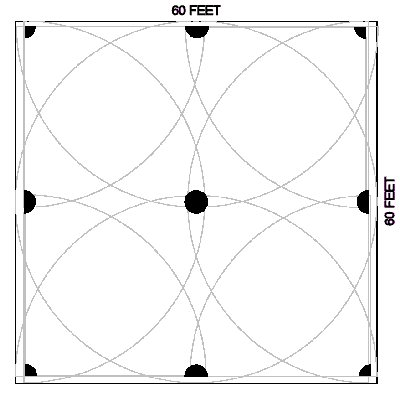{:height="256px" width="256px"}
{: .text-center}

- Place the main network (25mm pipe) as close as possible to the rotors;

**Note**: You can follow your house wall to make maintenance easier.
{: .notice--info}

- Place the secondary network (16mm pipe) to join the main network and the rotors;

**Note**: You can easily adjust the secondary network with flexible pipe (16mm)
{: .notice--info}

- Place the drop-by-drop network (16mm pipe)

**Note**: Drop by drop must pass through all plants. It will be easy to divide it into sub-networks with mini gates
{: .notice--info}



## Installation

### Dig trenches and set main pipe

- Dig trenches: 25cm depth and 20cm wide;
- Roll out and cut the pipe. Leave a margin to easily join the connectors.

#### Components:

| Component     | Description   |
|:-------------:|:-------------:|
|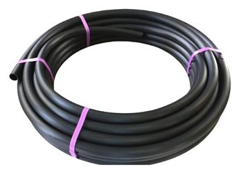{:height="48px" width="96px"} | Polyethylene pipe 25mm 25m HD 6Bars

**Tools**: Pickaxe, Spade, Stanley knife, Tape and Guiding line.
{: .notice--primary}



### Valve boxes

- Valve boxes must be located near the water main and electrical supply;
- Choose the right size according to the number of valves that you need;
- Dig a large hole to make work easier;
- Create a bed of pebbles for stability and to avoid mud after a water leak;
- Cut out the plastic entry for each valve.

#### Components:

| Component     | Description   | Unit price
|:-------------:|:-------------:|:-------------:|
| 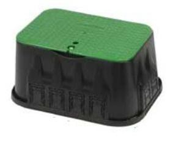{:height="48px"width="96px"} | Valve boxes Rain Bird 62x46x30,5cm  | 38.81

**Tools**: Pickaxe, Spade, Stanley knife, Tape.
{: .notice--primary}



### Water main supply

Now that the valve box is installed, we can connect to the water supply.
In my case, I had planned a 25mm pipe under my house to join my garden directly. So I just added
a brass union to connect the water supply to my 1/4 turn gate.

**Tools**: Wrench, teflon tape, stanley knife
{: .notice--primary}

**Note**: I also have another 1/4 turn gate in my garage to easily turn off the water on each side. It is useful to avoid water pipes
freezing.
{: .notice--info}

| Zone          | Description   | Quantity      | Unit price    | Total  |
|:-------------:|:-------------:|:-------------:|:-------------:|:------:|
| 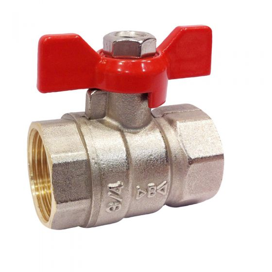{:height="48px" width="48px"} | Gate FF 26x34 | 1 | 10.75 | 10.75
| 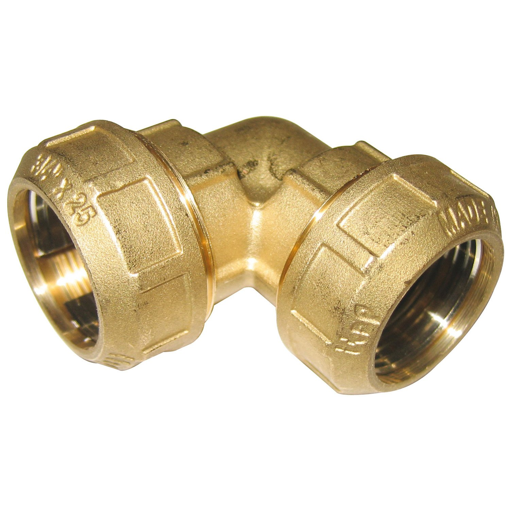{:height="48px" width="96px"}  | Brass elbow 19x25| 1 | 7.5 | 7.5
| 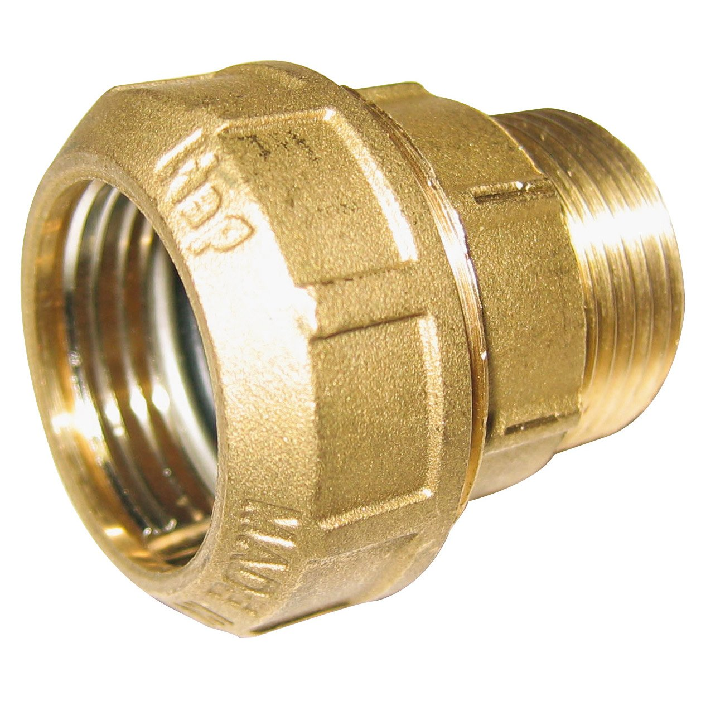{:height="48px" width="96px"}  | Brass adapter male 19x25 | 1 | 4.25 | 4.25
| 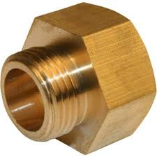{:height="48px" width="96px"}  | Brass nipple Female 20/27 -> Male 26/34 | 1 | 4.08 | 4.08
| {:height="48px" width="96px"} | Water Pressure Gauge INOX radial 0 à 6 bars x1 | 1 | 9.65 | 9.65
| 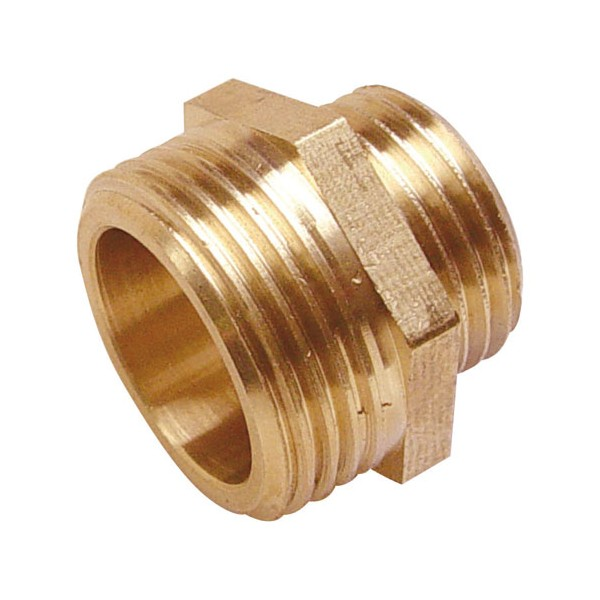{:height="48px" width="96px"}  | Brass adapter 26/34 Male -> 20/27 Male | 2 | 4.2 | 8.4
| 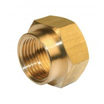{:height="48px" width="96px"}  | Brass adapter 20/27 Male -> 12/17 Male | 1 | 2.375 | 5.75
| 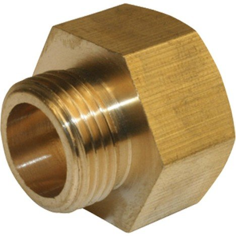{:height="48px" width="96px"}  | Brass nipple 8/13 Female-> 12/17 Male | 2 | 1.425 | 2.85
| 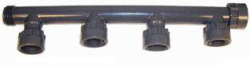{:height="48px" width="96px"}  |  Clarinet 1" | 1 | 16.06 | 16.06
| 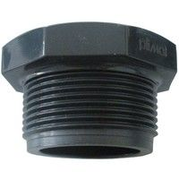{:height="48px" width="96px"}  | End plug PVC male 1"| 2 | 1.55 | 3.10
| 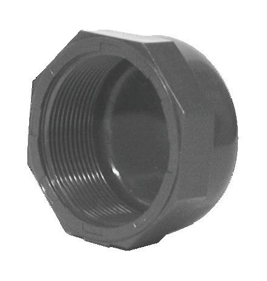{:height="48px" width="96px"}  | End plug PVC female 1" | 2 | 1.95 | 3.9
| 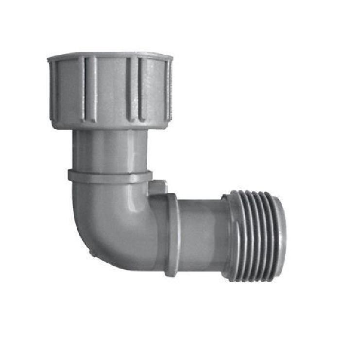{:height="48px" width="96px"}  | Elbow collector MF 1" | 1 | 5.05 | 5.05
| 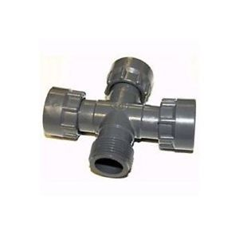{:height="48px" width="96px"}  | Cross collector 1"| 1 | 8.95 | 8.95
| 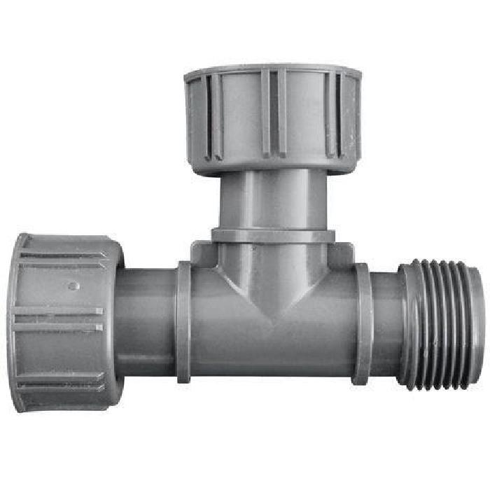{:height="48px" width="96px"}  | Tee collector 26x34 MF 1"| 1 | 4.2 | 4.2
| 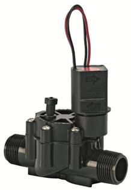{:height="48px" width="96px"}  |Irrigation valve RAIN BIRD DV 1" MM NR 24V | 4 | 14.94 | 59.76
| 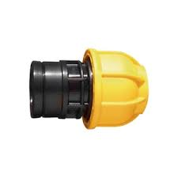{:height="48px" width="96px"}| Adapter compression 25mm  | 4 | 2.5 | 10.0
| - | - | - | - | 164.25



### Valves

Each project will be different depending on your number of valves, the location, the valve box... 
So you need to pay attention when designing your installation.
In my case, I designed it with 2 floors to install: 5 valves, 2 gates and 1 manometer. 

- Put Teflon on each thread that doesn't contain any seal.
- Every valve has a compression connector to join the main network (25mm).
- A pressure reducer is used for the drop-by-drop network (16mm).
- I added another 1/4 gate to supply my solar shower.
- I added a manometer to control the network pressure.
- Don't forget to leave some space for the electrical part.
     


### Connections

#### Wire pipes, elbows, tees and rotors

| Component     | Description   | Quantity | Unit price | Total    |
|:-------------:|:-------------:|:--------:|:----------:|:--------:|
| 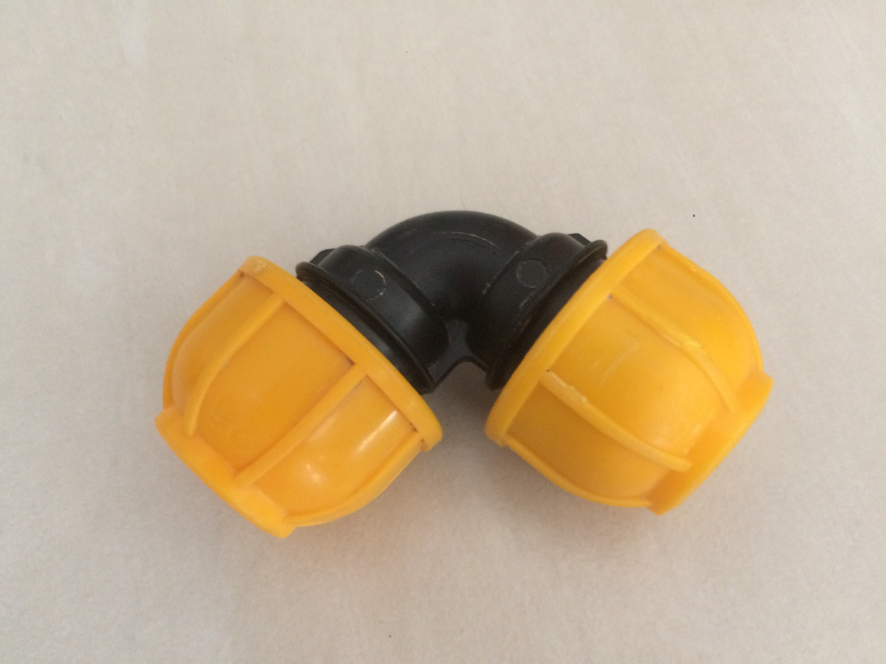{:height="96px" width="96px"} | Compression elbow connector | 14 | 3.05 | 42.7
| 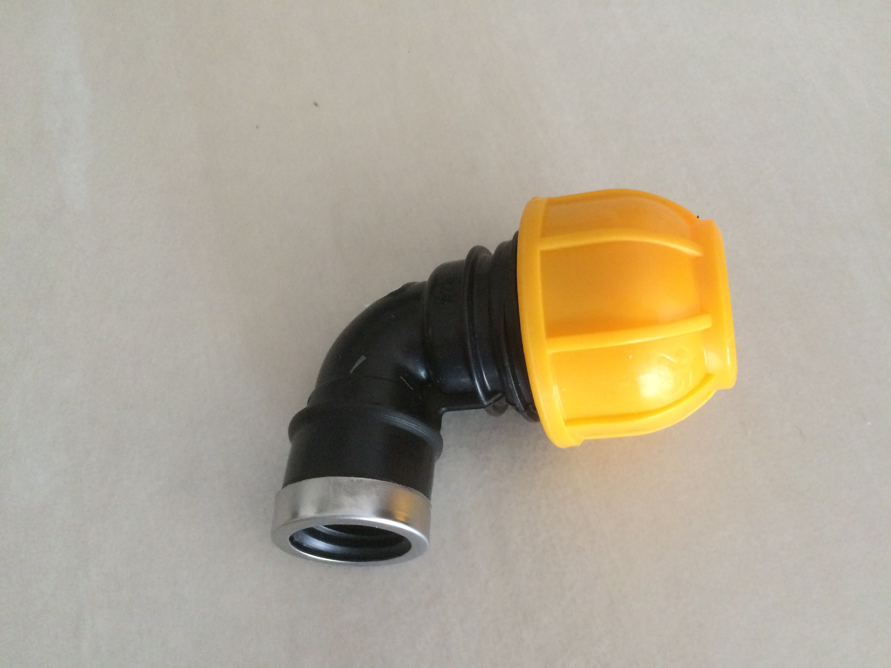{:height="96px" width="96px"}| Fitting compression elbow connector | 4 | 3.05 | 12.20
| 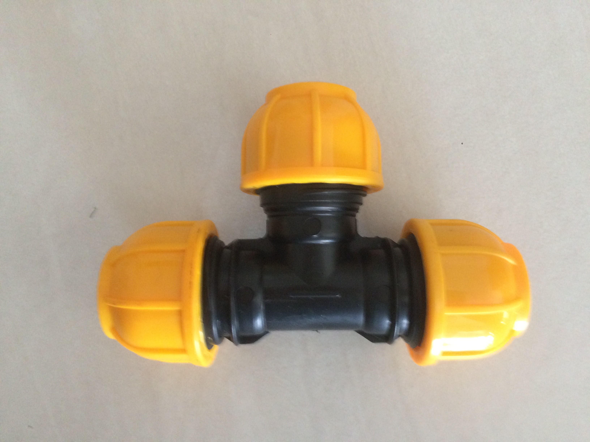{:height="96px" width="96px"} | Compression tee| 4 | 4.05 | 16.2
| 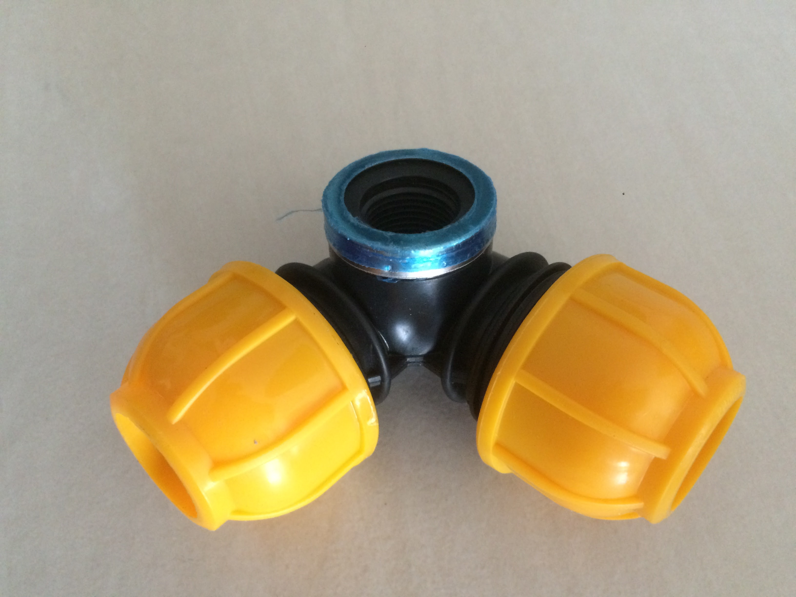{:height="96px" width="96px"}|Compression fitting female tee | 9 | 4.65 | 41.85
| 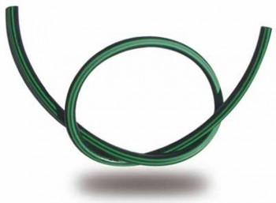{:height="48px" width="96px"}  |  swing pipe 30m SPX-FLEX 30m | 2 | 27.0 | 54.0
| {:height="48px" width="96px"}  | polyethylene irrigation pipe 25mm 50m HD 6Bars| 3 | 30.9 | 92.7
| 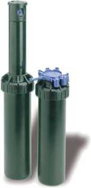{:height="48px" width="96px"}  | Rotor RAIN BIRD 3504 PC (1/2" F) | 13 | 6.97 | 90.61
| 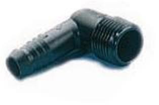{:height="48px" width="96px"}|Swing Pipe - 1/2" MNPT Elbow | 13 | 0.24 | 3.12
| 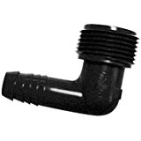{:height="48px" width="96px"}  | Swing Pipe - 3/4" MNPT Elbow | 13 | 0.24 | 3.12
| - | - | - | - | 356.3



## Drop By Drop



**Advice**:
- For the drop-by-drop network, we have to add a pressure reducer 1.2bars 17PSI (1 14.5 PSI to 1.5bars 21.75PSI)
- Add mini threaded valves to control the different zones (see components below).
- I set 1 dripper per bush, 3 drippers per palm tree, 2 drippers per conifer, 2 drippers per olive tree

Components:

| Component     | Description   | Quantity | Unit price | Total    |
|:-------------:|:-------------:|:--------:|:----------:|:--------:|
| {:height="48px" width="96px"}  | Irrigation valve RAIN BIRD DV 1" MM NR 24V | 1 | 14.94 | 14.94
| 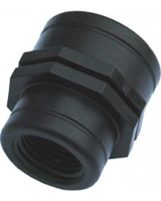{:height="48px" width="96px"}  | Reducing Coupling Female Thread female/female 1" -> 3/4"  | 1 | 2.05 | 2.05
| 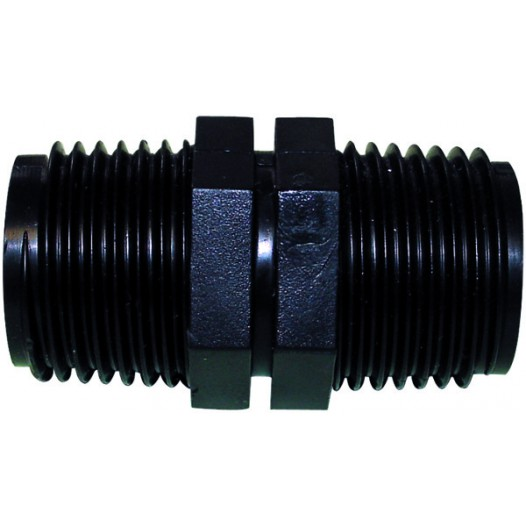{:height="48px" width="96px"}  | Nipple PVC male/male 3/4" | 1 | 1.09 | 1.09
| 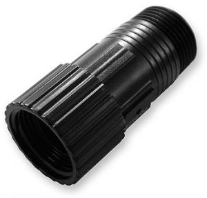{:height="48px" width="96px"}  | Pressure Regulator 3/4" Hose Thread 25PSI female/male 3/4"  | 1 | 5.99 | 5.99
| 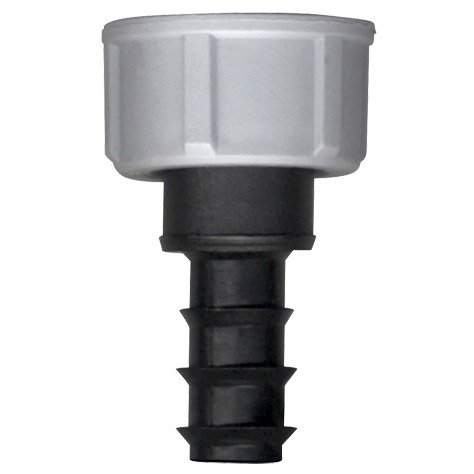{:height="48px" width="96px"}  | Thread adapter male 3/4" -> 16mm  | 1 | 0.42 | 0.42
| 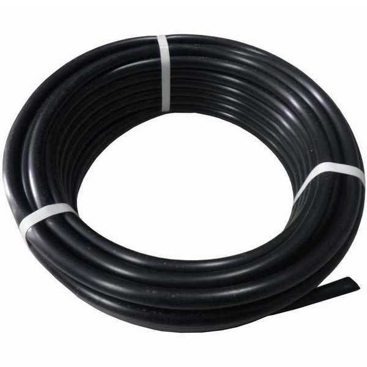{:height="48px" width="96px"}  | polyethylene irrigation pipe 16mm 25m | 5 | 6.90 | 34.5
| 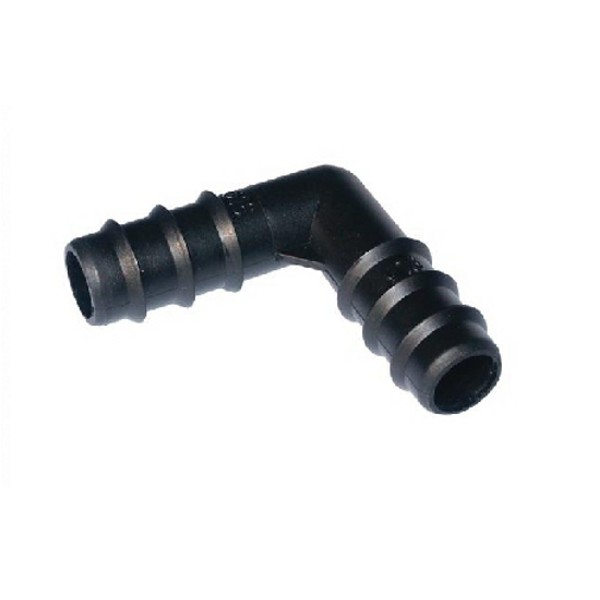{:height="48px" width="96px"}  | Elbow 16mm  |  6 | 0.25 | 1.50
| 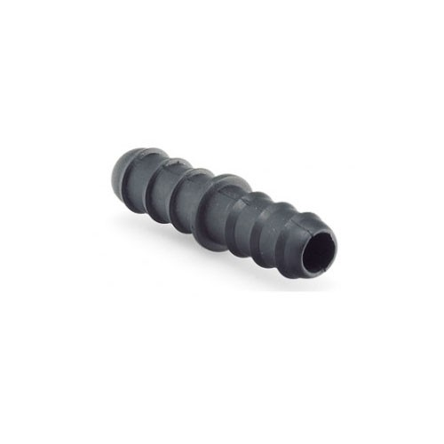{:height="48px" width="96px"}  | Adapter 16mm | 6 | 0.25 | 1.50
| 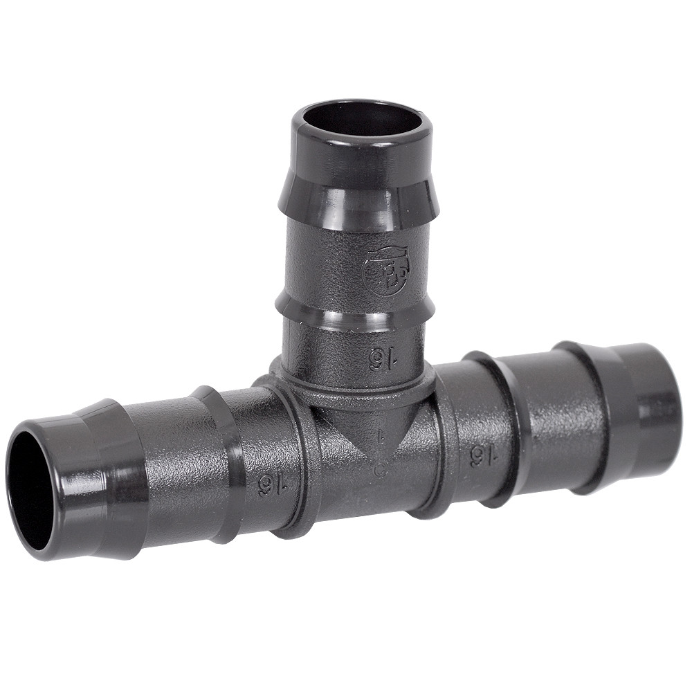{:height="48px" width="96px"}  | Tee 16mm  | 4 | 0.54 | 2.16
| 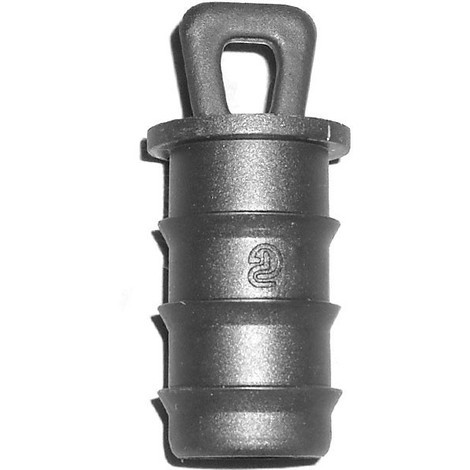{:height="48px" width="96px"}  | End plug connector 16mm| 8 | 1.65 | 13.2
| 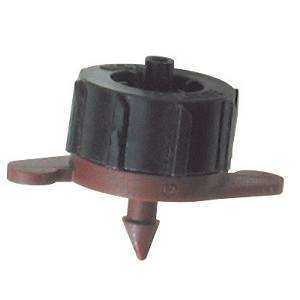{:height="48px" width="96px"}  | Dripper | 100 | 0.23 | 23.0
| 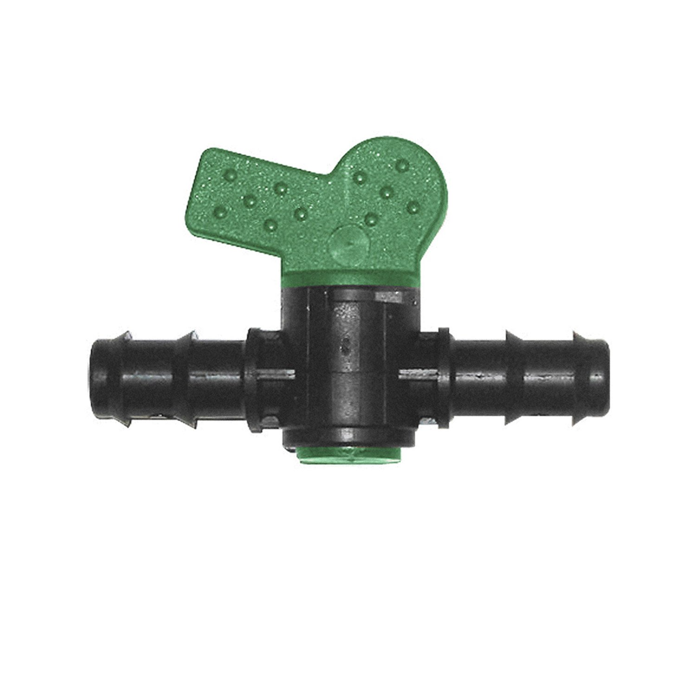{:height="48px" width="96px"}  | Mini threading valve 1/4-turn male/male 16mm  | 6 | 2.45 | 14.7
| -  | -  | - | - | 115.05

Tools:

| Component     | Description   | Price |
|:-------------:|:-------------:|:--------:|
| 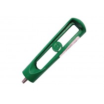{:height="48px" width="96px"}  | Irrigation hole punch  | 3.40

## Result test

- Open the main gate.
- Check the pressure and that the joints are properly made
- Open the gate manually with a 1/4 turn.
- Use a screwdriver to adjust your rotor coverage.
- Total cost for my project: 677.81€

**Tools**: screwdriver.
{: .notice--primary}

We can now use the sprinkler manually from the valve box. The next tutorial will describe the electrical and electronic
part to automate the system.


