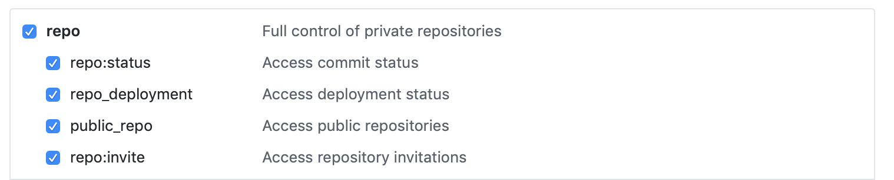
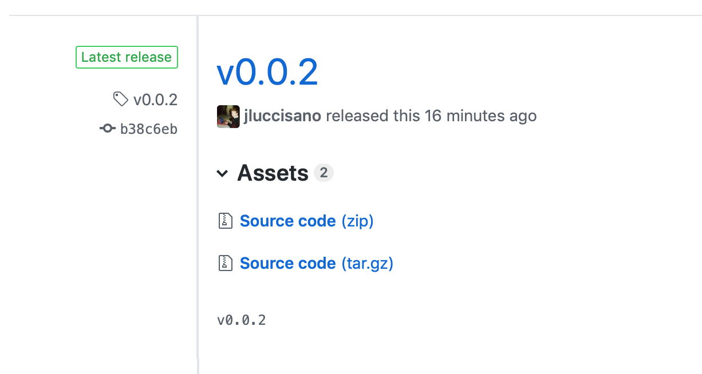

> **Legacy post.** This article was written between 2016 and 2018. Software versions, commands and services mentioned here may be outdated. Check the official documentation before running anything.

The goal of this tutorial is to set up Travis CI to deploy releases to GitHub and Docker Hub


- [Prerequisites](#prerequisites)
- [Deploy GitHub release via personal OAuth Token](#deploy-github-release-via-personal-oauth-token)
- [Deploy Docker image to Docker Hub](#deploy-docker-image-to-docker-hub)

### Prerequisites

- Travis CI account
- DockerHub account
- Github account
- Install Ruby [https://guides.rubygems.org/rubygems-basics/](https://guides.rubygems.org/rubygems-basics/)

### Deploy GitHub release via personal OAuth Token

#### Create an OAuth Token

Go [here](https://github.com/settings/tokens) and create a new one.

Make sure you have at least these permissions:



#### Encrypt the GitHub

Go to the folder where your .travis.yml is located.

Install the Travis tools

```bash
gem install travis
```

Copy the token you generated earlier and replace $YOUR_TOKEN with it.

```bash
travis encrypt GITHUB_TOKEN=$YOUR_TOKEN --add
```

This command encrypts your token and adds the encrypted key to your .travis.yml:

```yaml
env:
  global:
    secure: sOQ51G...
```

Then you can use the $GITHUB_TOKEN variable in .travis.yml to set the api_key.

```yaml
deploy:
  provider: releases
  api_key: $GITHUB_TOKEN
  file: dist/*
  skip_cleanup: true
  on:
    tags: true
```

Then create a tag and push it:

```bash
git tag -a v0.0.1 -m "Release version v0.0.1"
git push --tags
```

Travis will automatically trigger a new build and deploy it.

Finally, go to https://github.com/$GITHUB_USERNAME/$GIT_REPO/releases. You can see your package released!




### Deploy Docker image to Docker Hub

#### Create encrypted variables $DOCKER_USER and DOCKER_PASSWORD

Go to the folder where your .travis.yml is located.

Install the Travis tools

```bash
gem install travis
```

Replace these with your Docker Hub username and an access token (Docker Hub expects an access token, not your account password).

```bash
travis encrypt DOCKER_USER=username --add
travis encrypt DOCKER_PASSWORD=<your-access-token> --add
```
This command encrypts these values and adds the encrypted keys to your .travis.yml:

```yaml
env:
  global:
    secure: sOQ51G...
    secure: qiQR2A...
```

Then you can use the $DOCKER_USER and $DOCKER_PASSWORD variables in .travis.yml.

#### Set up .travis.yaml

```yaml
services:
- docker
```

```yaml
script:
- export TAG=`if [ "$TRAVIS_BRANCH" == "master" ]; then echo "latest"; else echo $TRAVIS_BRANCH;
  fi`
- docker build -t $REPO:$TAG .
after_success:
- echo "$DOCKER_PASSWORD" | docker login -u "$DOCKER_USER" --password-stdin
- docker tag $REPO:$COMMIT $REPO:$TAG
- docker tag $REPO:$COMMIT $REPO:$TRAVIS_BUILD_NUMBER
- docker push $REPO
```

```yaml
env:
  global:
  - secure: B8Z5pvFYnGMQR...
  - secure: hmVbuNH4Z....
  - COMMIT=${TRAVIS_COMMIT::8}
  - REPO=$DOCKER_USER/chrono
```