In this article, I will describe all the steps that allowed me to make my first homemade wheel.

As soon as I started cycling, I quickly became interested in bicycle wheels and understood the importance
that they had in terms of performance, comfort and sensations. I bought several inexpensive pairs without
worrying about all the criteria. Then I had a pair of handcrafted wheels (38mm) assembled by a professional.
These wheels go everywhere. They are light, which makes them reactive, and their height gives them an
aerodynamic touch. One day, a spoke broke on me, and that is when I started to take an interest in the wheels.
Indeed, repairing my broken spoke led me to start my research and deepen
my knowledge about it. I am passionate about sport, always thirsty for knowledge and
new challenges. I embarked on this new challenge, aiming for a specific wheel that optimizes
aerodynamics on the flat courses of some triathlons or duathlons I am used to
participating in. I wanted an aerodynamic wheel that keeps good inertia once it is rolling. It also had to be light and rigid
to accelerate again effectively. Finally, it had to transmit with the least possible loss all the power
supplied by the cyclist.
{: .text-justify}

My goal is not to "reinvent the wheel", so I will mainly share my feedback,
share what I learned, the choices I made, and the articles and books that helped me finalize my
first wheel. First, I will detail all the steps that helped me choose all the
components. Then, I will share the assembly experience, and finally I will finish with my first road test.
{: .text-justify}

# Characteristics

A wheel suitable for all routes and all climatic conditions does not exist. This is why
cyclists generally have several pairs, for example one for training and one
for competition or to suit different events. Today it is possible to build many
set-ups to suit all types of routes (mountains, flat or hilly), climatic conditions (meaning
 and strength of the wind, rain) and rider (climber, roller, puncher ...). With all these parameters, one
would need 20 pairs in his garage... which is quite difficult to achieve and
 especially difficult to get his wife to accept that. So you have to compromise, and for that you have to ask yourself
good questions. A good wheel means nothing without taking into account the context of the course,
the environment or the type of cyclist. I will try to describe the physical properties of a wheel, so that you can
 determine which parameters to adjust to build the wheel we really need.
{: .text-justify}

A wheel is subjected to 3 types of force that cause deformation: radial, lateral and torsional. It is with
these 3 types of force that let us talk about the stiffness of the wheel. The radial force is the force induced
by the weight of the cyclist and the compression against the road. A good wheel has to support the weight of the cyclist
without deforming. A carbon or aluminum rim today offers plenty to support this load.
The lateral force acts on the wheel when the cyclist starts dancing on the pedals, and the torsional force is
  caused by the power developed in the pedal stroke and transmitted to the hub. For these forces, a hub
  strong, well-tensioned spokes allow the least deformation and therefore transmit the maximum of the
power developed up to the road. The more the wheel transmits the developed power, the more rigid the wheel. 
{: .text-justify}

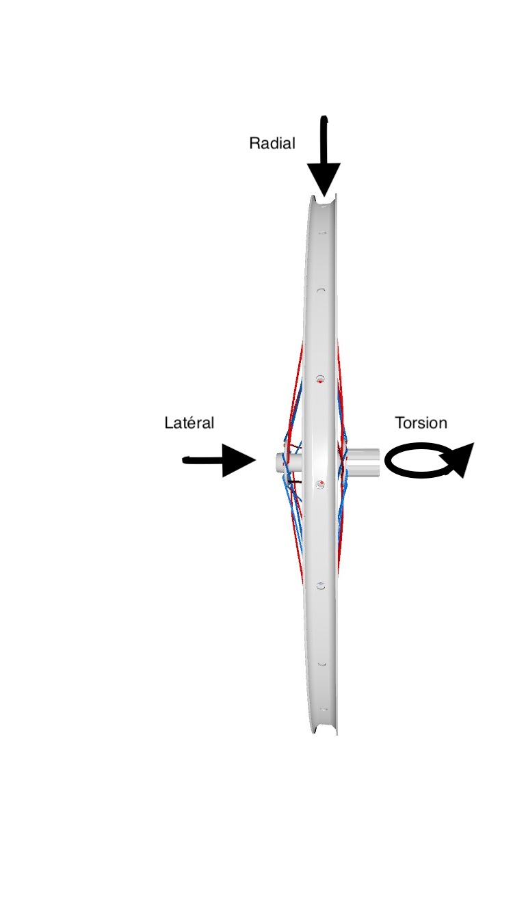{: .align-center :height="320px" width="320px"}

Then, a rolling wheel has inertia. To
have as much inertia as possible, you have to optimize its aerodynamics, but not only. Indeed, the heavier we are,
the faster we go once launched. But it is wise to optimize aerodynamics more than to increase the weight,
because the heavier we are, the harder it is to reach the moment of inertia. Like a train, which must provide a
enormous torque at start-up, but once launched it keeps moving with very little energy. But a cyclist needs
  to keep accelerating all the time, which is not possible.
{: .text-justify}

To obtain an aerodynamic wheel, you have to adjust the rim height, the number of spokes, the width of
 the rim, or the number of spokes and their shape. The ideal is a solid wheel, where the air flows straight
 outside. It is also heavier, so once launched it has optimum inertia. The cyclist can go
 faster with the same power. But a solid wheel is harder to restart, and if the wind is
 side, it becomes a burden. So a full wheel is useful for
lap time on flat ground with a favorable wind. The compromise is therefore to adjust the height of the rim. For example,
an 88mm offers more aerodynamics than a 38mm, because it has a larger air exhaust area. But you also have to
be careful not to have too many spokes, because more spokes mean more friction. And we have to opt
for flat spokes to limit this friction. The width of the rim may
also help the air flow away cleanly, and finally it needs a hub that offers the least friction at
bearing level. In addition, aerodynamics matter mostly at the rear. Indeed, at the front it matters much less
of importance because in all cases the air has to pass the width of the cyclist. We must also think that the more the
wheel is at the front, the more the bike
will be less controllable. The gain from a 50 or 88 wheel at the front is so small that it is better
to prefer good bike control. Finally, you only feel the inertia above 30-35km/h, so if you are not
able to reach this speed it is useless. Too many cyclists ride bikes they cannot push,
and they suffer every Sunday. Admittedly it is beautiful and looks professional, but it is not suitable.
{: .text-justify}

To obtain a dynamic wheel that responds well to attacks, you need a light wheel, so you have to optimize
the weight of all the components, but it also has to be rigid enough to handle lateral forces when you dance on the pedals.
So a carbon wheel will feel more responsive. For a hilly course with lots of changes of pace, a pair of
38mm with a light hub gives both dynamism and a touch of aerodynamics. It is really the versatile wheel
because even when there is wind, it does the job. They are a really good compromise, and we see more of them in the peloton.
{: .text-justify}

For pure mountain riding you need the lightest wheel possible, so you have to choose a rim that is
low, not wide, with few spokes and a light hub.
{: .text-justify}

For group rides on flat routes, for rouleur-type cyclists or sprinters, we can opt for a pair of
50mm, but with a hub with high flanges, which is more rigid because the spokes are
  short. A wheel that is aerodynamic enough, yet easy to accelerate, can hold the wheels of the peloton and push
   big gear for sprints.
{: .text-justify}

There are still plenty of possible combinations given the number of parameters.
A good wheel results from a good combination of all these components, according to the needs of the rider.
  Above all, we cannot say that a wheel is good just because it is visually beautiful.
What I recommend is to have several types of wheels, depending on the route and the conditions. Of course, we
cannot have 20 pairs. But 2 or 3 pairs can cover a large number of cases.
{: .text-justify}

# Components

I will detail the different components I have chosen, according to my needs.
{: .text-justify}

## Rim

### The height

Since I am looking for an aerodynamic wheel, mainly to roll on flat ground, I will
take a rim with an 88mm height. The best would be a solid wheel, but it would be used very rarely
while an 88mm will still be dynamic enough to handle hilly sections. To choose, you must
make the best compromises according to their needs, their terrain and the environmental conditions.
So an 88mm seems to me a good compromise, dynamic enough to handle hilly parts and
to enjoy it regularly. In the Lauragais, I could only take a full wheel out twice a year.
{: .text-justify}

### The width

Studies have shown that air flowing off a wider rim at the rear would improve aerodynamics.
In addition, wider also means more comfort, so I will try to opt for a width of 25mm, which is a little
fashionable.
{: .text-justify}

### Number of holes

The fewer the spokes, the more aerodynamic the wheel will be. But that necessarily weakens the wheel even if you are light.
You also have to think about braking and sprinting at full power. Putting 20 spokes in front is okay, but
for a rear wheel it is better to start at 24. On hubs called Straight Pull (with straight spokes)
you can put 20 at the back, because the straight spokes are less fragile. I think I will test this type of assembly
for my next pair. Finally, putting more than 24 would have the opposite effect. The right compromise would be to put a wheel
with a stick (Jalabert style), a little more versatile than a solid wheel. I opted for a classic assembly with
symmetrical holes.
{: .text-justify}

### Material

No surprise, I chose 3K T800 carbon fiber, like most carbon wheels on the market,
light and rigid.
{: .text-justify}

### Tubular tire

I chose a tubular rim. I will detail my tire and tubular choice in a dedicated chapter later.
{: .text-justify}

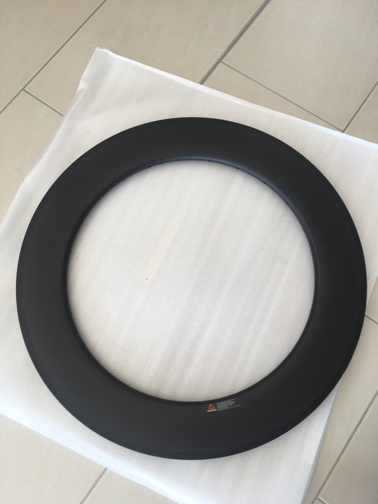{: .align-center :height="320px" width="320px"}

Characteristics:
- Diameter: 700C
- Material: carbon, T800 3K
- Type: Tubular
- Height: 88mm
- Number of holes: 24
- Width: 25mm
- Finish: Matte UD
- Weight: 520g +/-5g

I found a supplier among many others on AliExpress. There is a lot of choice, but you still need to find a
serious supplier: a good rating, a good number of sales, a detailed description, delivery costs
reasonable, and a guarantee. I was able to exchange messages directly and very quickly, and the delivery time was
clear. I am very satisfied, though it will need to be checked over the long term, with use. But on delivery, I was amazed by
  visual quality.
{: .text-justify}

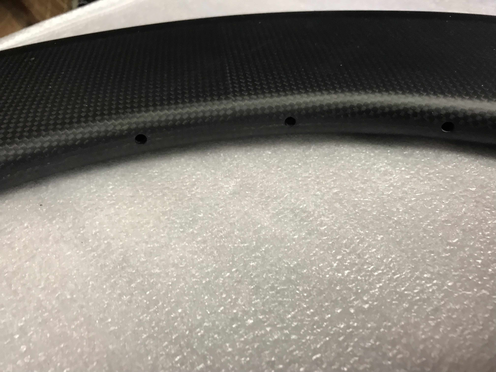{:height="320px" width="320px"} 
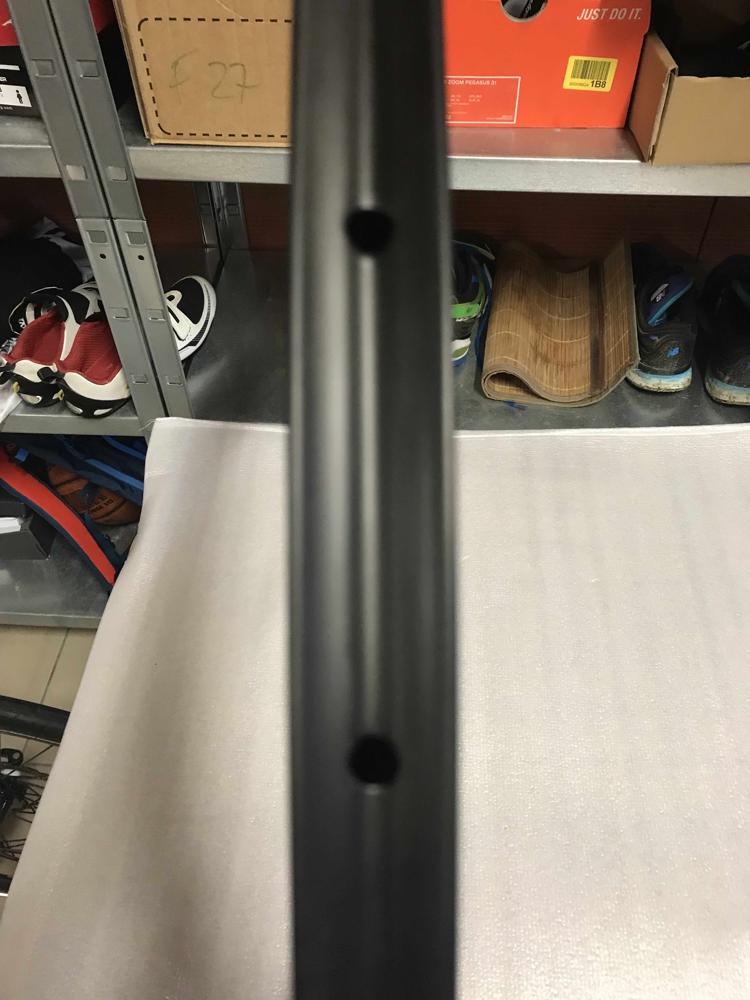{:height="320px" width="320px"} 

- Price: 67.36 €, plus 36.51 € for shipping costs, for a total of 103.87 €

## Hub

The hub is arguably the most important component of a wheel. It is therefore very important to choose
a good quality hub. If you have to spend money, spend it on the hub. There are lots of good ones
hubs, but which one is useful depends on the context. A light hub gives better dynamism, and a heavier hub
gives more inertia. The height of the flanges is important: the wider they are, the shorter the spokes,
the stiffer the wheel, and vice versa. More information [here](https://www.roue-carbone.com/guide-achat/le-moyeu-de-roue-de-velo).
  Finally there are many other parameters to take into account:
{: .text-justify}

- The width of the frame on which the hub will be installed (130mm in my case, which is common on road bikes)
- The material, which necessarily affects the weight (alu or carbon)
- The type of bearings is what often drives up prices. Good bearings that allow the least
possible friction, and therefore less loss. There are very expensive ceramic bearings. You must also
look at the quality of the seals. You can have good bearings, but as soon as you ride in the rain
they get dirty and you lose all efficiency. Finally, look at the maintenance required, if any.
- Look at the type of cassette (Shimano, Campagnolo...) and the number of gears
- The number of holes on each side, depending on the assembly you want to make.
- The type of disc brake or v-brake
- Classic or Straight Pull. Straight Pull hubs are trendy because they last longer
by using straight spokes. In fact, we can use a few fewer spokes and therefore get better
aerodynamics (I will test it on a next pair. Apparently it has not been proven yet, so let's take the time and
give more weight to feedback than to marketing).
{: .text-justify}
 
For my first wheel, I did not want to start with a high-end hub (they go up to 500 euros). I have
looked for good value for money. The American brand Novatec is a good compromise, because it is possible
to buy them directly from China, and fewer intermediaries means a lower price. So I need a hub:
{: .text-justify}

- 130mm spacing
- Shimano 11v compatible
- V-brake
- J-bend spokes (angled)
- I want to build a 24-hole wheel with 2 crossings on each side. So I need a hub with 12 holes
each side.
- Aluminum and light.
- A high flange (but not too high).
- Low maintenance and well-tested bearings.

I chose the hub [Novatec F482SB](http://www.novatecusa.net/product/f482sb-sl-11s/)
which meets my specifications above.

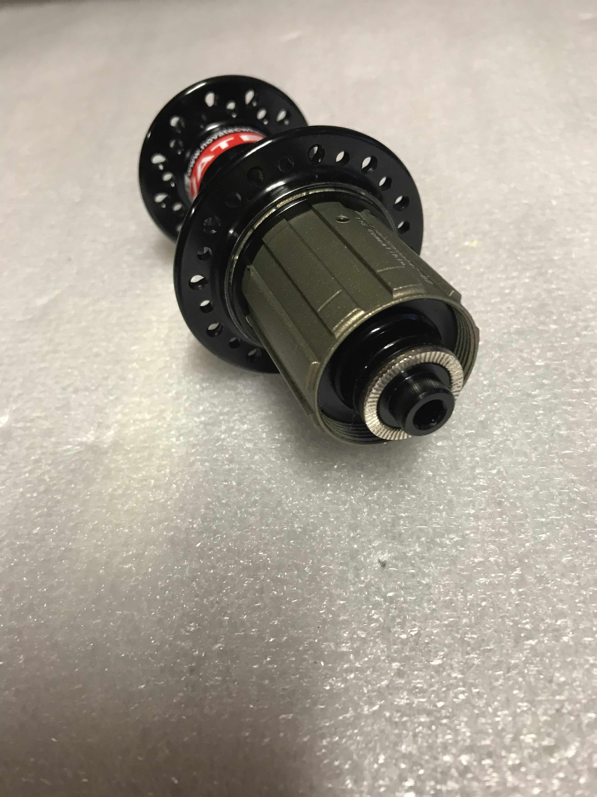{:height="200px" width="200px"} 
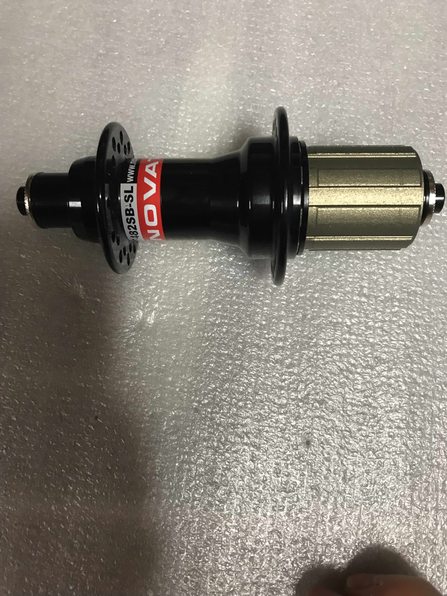{:height="200px" width="200px"} 
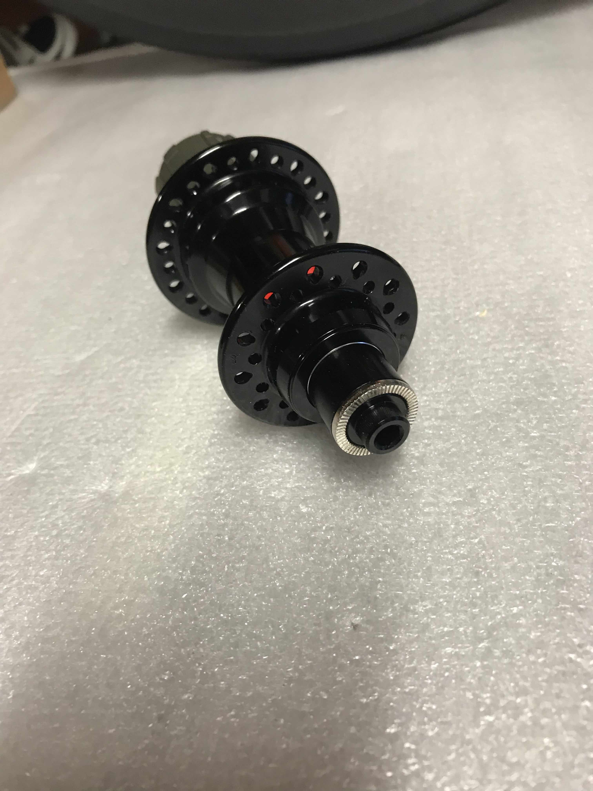{:height="200px" width="200px"} 

Price: 59.98 € including shipping costs

## Spokes

Since I want to build an aerodynamic wheel, I went straight for flat spokes.
The 2 major brands are Sapim and Dt-Swiss. I chose the Sapim CX-Ray,
which are light, very fine and strong (made of steel) [Sapim CX-Ray](https://www.sapim.be/spokes/aero/cx-ray).

Be careful not to buy the spokes yet. A chapter will be dedicated to this later.
{: .notice--danger}

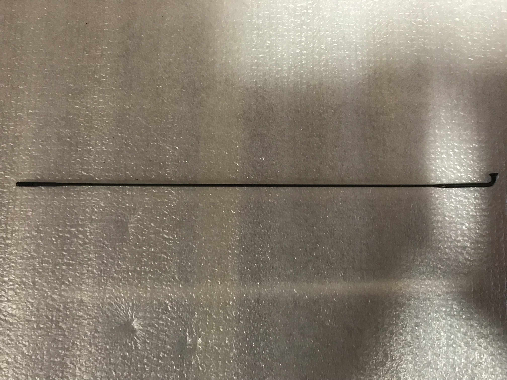{: .align-center :height="320px" width="320px"} 

- It is possible to choose the color
- In addition, I took J-Bend spokes (bent). Straight spokes are intended
for Straight Pull hubs. Spokes of this type are less stressed because they have no elbow.
I think I will test on another pair.
{: .notice--primary}

Price: 2.20 € each

## Nipples

As for the nuts, we can take whatever we want, since each brand offers
different lengths or heads. My choice is the same as
for the spokes, at Sapim [Double Square](https://www.sapim.be/nipples/design/double-square).
The Double Square has a square head which allows you to use this tool (see image
below). Given the height of the rim (88mm), this type of tool makes it easy to screw them in,
we will see it during the assembly. The aluminum and brass mix makes them both light and strong.
{: .text-justify}

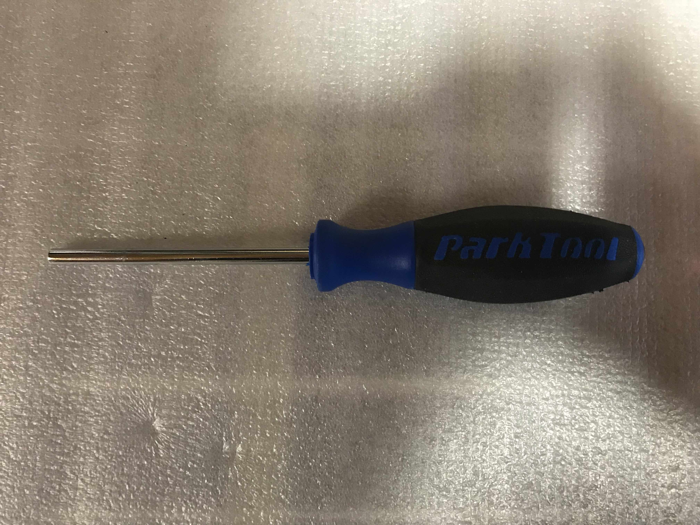{:.align-center :height="240px" width="240px"} 

- Look at the material: 100% alu nuts are more fragile.
- Pay attention to the type of head. Some brands, like Dt-Swiss, have nuts that need their own special tools.
- Look at the size: there are 12-14-16mm. Above all, you need the thread details so,
we will see later, choose the right length of the spokes.
{: .notice--danger}

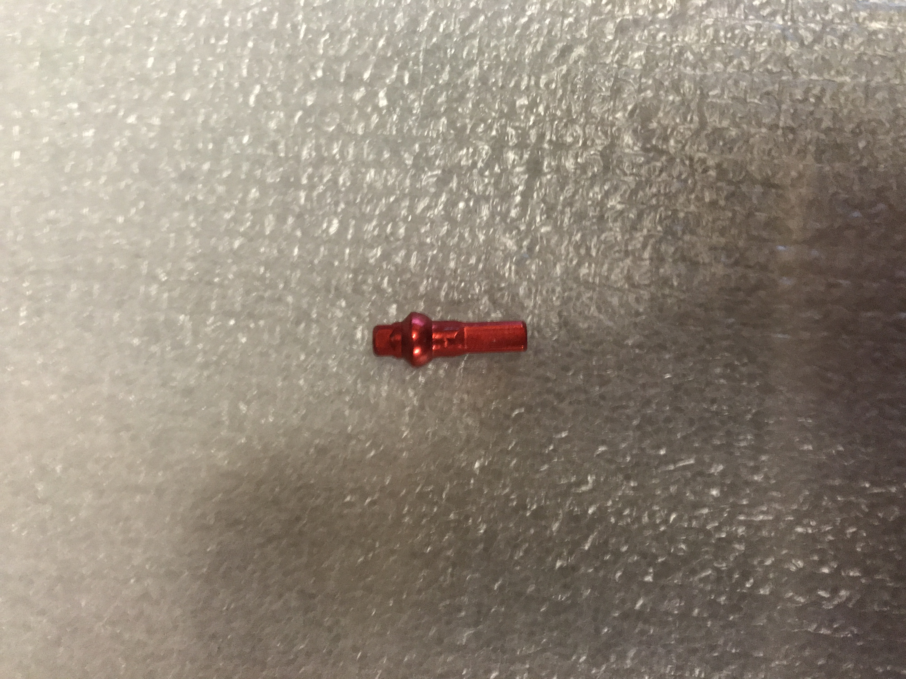{: .align-center :height="320px" width="320px"} 

There are different colors. I chose to alternate red and black, just for the "style"
{: .notice--primary}

Price: 0.40 € per unit

## Tire or Tubular

This is always the big question among cyclists. I will give you my personal opinion on this. The tubular
and the tire all have different characteristics from their designs and can bring
different benefits. It all depends on the compromises you are ready to make, according to your needs. In
In any case, a good quality tire will always be better than an entry-level one, and vice versa. There are
many articles about this subject. I invite you to read the one that sums it up best:
[Difference between Tire or Tubular](https://www.roue-carbone.com/guide-achat/difference-entre-pneu-boyau-de-velo) {: target = "_blank"}
{: .text-justify}

Even if the tubular has many drawbacks in terms of practicality:
- Always carry a spare tubular
- the installation is a little more delicate and long. It must be done in several stages, and you have to buy
glue.
- A puncture is expensive, because you have to change the whole tubular and not just the inner tube
- The braking is less precise, because you brake on the rim directly (unless you have disc brakes, of course).

But they have advantages in terms of performance. They are often lighter for an equivalent range
in tires. They absorb road bumps better, which makes them more efficient and also more comfortable. Also,
we can run a higher pressure, which means less grip on the ground and therefore less
friction. But you still have to choose a quality one. Since I started riding tubulars, I wouldn't want to
go back to the tire, but that's my personal opinion. But it is important to choose a quality tubular or tire
because it would be a shame to waste the effort put into the underlying components. In other words, the tubular or tire is
the last element before the road so you have to be able to transmit the maximum force with the least losses.
{: .text-justify}

What characteristics should be taken into account when choosing a tire or a tubular?

### TPI

TPI = Threads Per Inch

This is the number of threads making up the carcass.

The higher the value, the more flexible the carcass is (because the threads are thinner) and the harder it is to puncture.
(at the expense of weight; in the end, everything depends on the materials).
{: .text-justify}

### Width

[Each rim has its own tire width](https://engineerstalk.mavic.com/fr/a-chaque-jante-sa-largeur-de-pneu/) {: target = "_blank"}

After reading this article, we understand the advantage of a wider tire at the back, especially when
we are looking for aerodynamics, and it also improves comfort. That is why I chose a 25mm rim
and a 25mm tubular.
{: .text-justify}

### Others

There are plenty of other parameters to look at, including the type of valve and especially its length. Indeed,
given the 88mm rim height, I will need a valve extender. You also have to pay attention
to the material, which affects performance: grip, wear, behavior on wet roads...
Finally, look at the weight and, of course, find the best quality-to-price ratio for your needs and budget.
{: .text-justify}

Finally, here is what I chose for the best quality-to-price ratio that meets my needs:

The Vittoria CX Tubulars really have high-end features for a reasonable price. I already had
  chosen these tubulars for my 38mm. I have been very happy with them for years and several thousand kilometers
  on the odometer.

- Presta valve 34 mm
- 25c
- 320 TPI
- 250g
- Price: 34.99 €

## Quick hitch

I use the same ones for all my wheels, so there is no need to buy them. What matters is the weight,
so if you have low-end quick couplers, it's best to have a light pair. That would be a shame
to lose all the weight gained with the previous components.
{: .text-justify}

## Cassette

The same goes for the cassette. You do not necessarily need one for each wheel, or at first. Swapping
the cassette takes ten minutes, which has the advantage of letting you clean it well. It all depends on whether you change
wheels at each outing or from time to time. A cassette costs around 50-60 euros, so we can get by with
one at first, then buy another later to swap them quickly.
{: .text-justify}

## Brake pad

Since I opted for a carbon rim, I need suitable brake pads. I opted for SwissStop
FlashPro Black Prince, which has the advantage of also being compatible with aluminum rims, so I don't have to
swap pads when I use my wheels with tires in winter or on a home trainer.
{: .text-justify}

# Design

## Spoke length

Choosing the right spoke length is probably the most important and
delicate step. In fact, a 1mm mistake, too short or too long, can prevent the mounting of the wheel
during tensioning. The length of the spokes will depend on the hub, the rim,
the number of spokes and how you want to lace the spokes. Basically, everything chosen
previously is a parameter that defines the length of the spokes. You will understand,
this is why you cannot buy the spokes before choosing all the previous elements.
{: .text-justify}

To do this, you need to collect a number of parameters to determine the correct
length. Some measurements can be collected from manufacturers, but there are often errors
so you need to be very precise and check them yourself. Once you have all the parameters, it is possible
to use online calculators that directly give the correct length of your spokes.
But I'm curious ... and to master something well, I think
you really have to understand what is behind an algorithm. It is certainly very useful to gain
time. So throughout this chapter, I am going to show how I got my spoke length
step by step.
{: .text-justify}

### Overview

I like to start with the final result, so here is an overview of what
we are trying to determine (S).

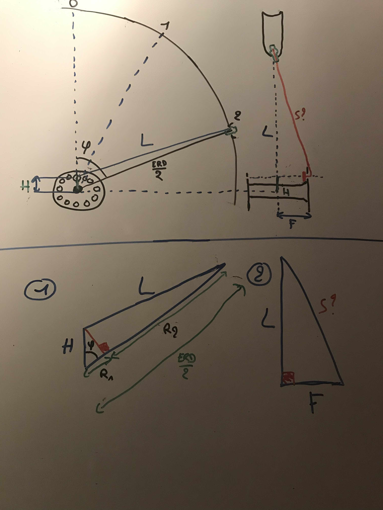{:.align-left .text-justify: height = "480px" width = "480px"}

In this diagram, I have represented a front view on the left and a top view on the right. The spoke in the stretched position
is shown in red with the currently unknown variable S that we will determine.
It can be seen that the hub is centered relative to the rim, which causes an angle for
the spoke to reach the rim. In green, I represented the nut, which is where the spoke will be housed when tensioned.
Below, I simplified the 2 diagrams into 2 triangles, HLR and LSF, with only unknowns for now, which
we can replace.

HLR triangle
- H = The distance between the center of the hub and the hole where the spoke will be housed
- L = An intermediate length that links the 2 triangles
- R'= ERD/2 This is the effective radius of the rim (I will detail this in the next chapter)
- Phi = Angle that the spoke will take, depending on the number of crossings
{: .notice--primary}

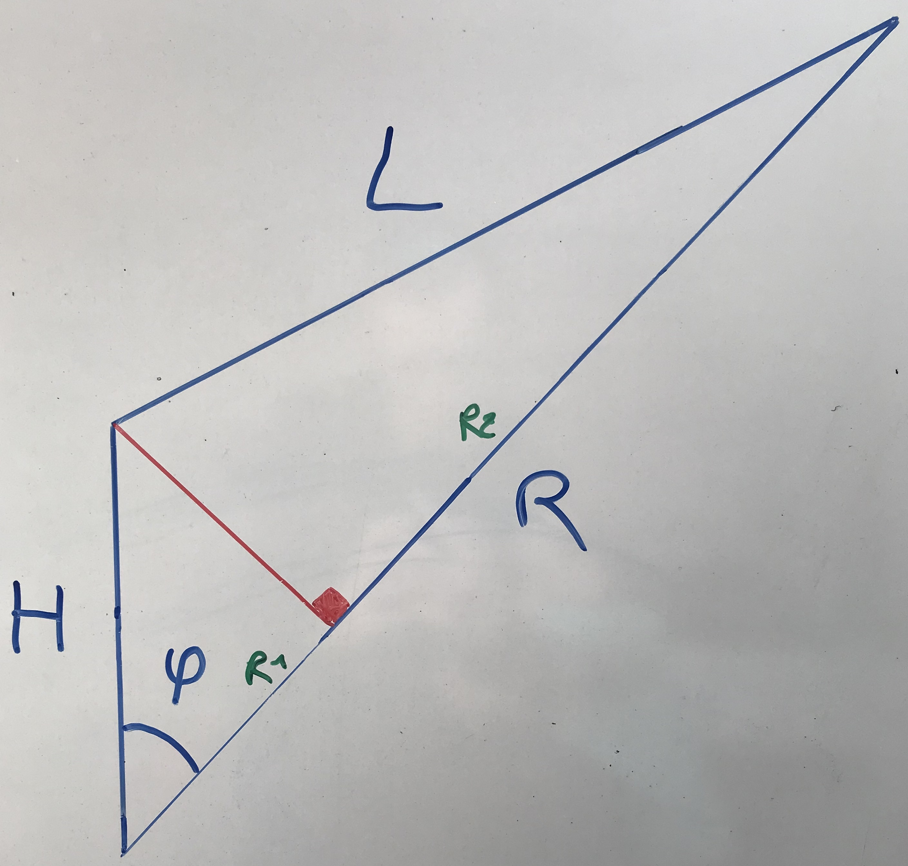{:.align-center :height="320px" width="320px"}

LSF triangle
- L = Intermediate length calculated in the triangle HLR
- S = The length of the spoke
- F = The distance between the hub flange and its center
{: .notice--primary}

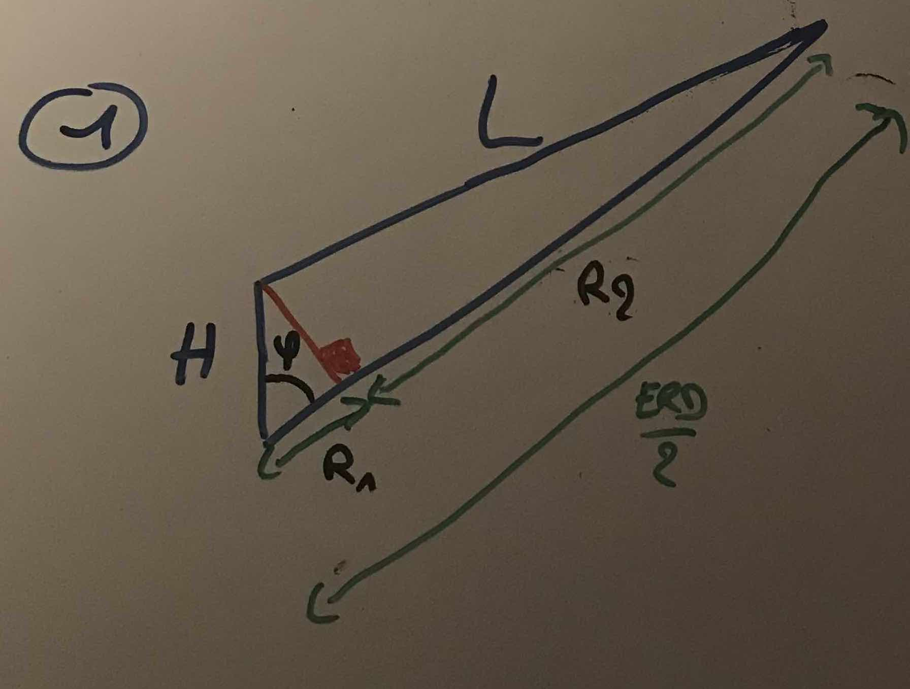{:.align-center :height="320px" width="320px"}

So first, I will describe how to take the different measurements on the rim and the hub. Then
in a second step I will be able to deduce the value of L in the triangle HLR and substitute L in the
triangle LSF to deduce the value of S.
{: .text-justify}

### ERD measurement

The ERD (Effective Rim Diameter), as I said above, is the rim diameter
, taking into account the distance where the spokes will really sit in the nipples. The ERD
is sometimes supplied when buying a rim, but the supplier often does not take the type of nut into account. It
means the diameter inside the rim. My supplier gave me an ERD of 464.5mm. We will see that in the end
we will be very far from this value. So how do you measure it? I've watched a lot of videos and
tutorials. The one that seemed simplest, most precise and effective to me is the following. Once again,
this is my personal opinion.
{: .text-justify}

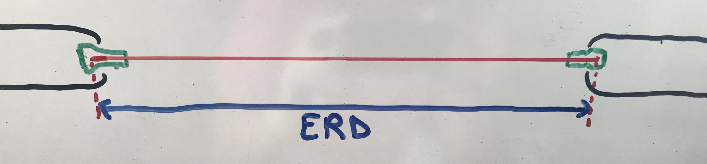{:.align-center :height="480px" width="480px"}

So just take 2 spokes, 2 nuts, tape, a rubber band and a caliper
(a simple tape measure may suffice).

- I take the 2 spokes that I bought separately, I took 200mm, but we can take any length.

- We insert them in the rim with the nuts. But there, you have to be rigorous,
the position of the spoke must be exactly where you want it when it is under
tension. I chose Sapim Double Square (see paragraph above).
{: .text-justify}

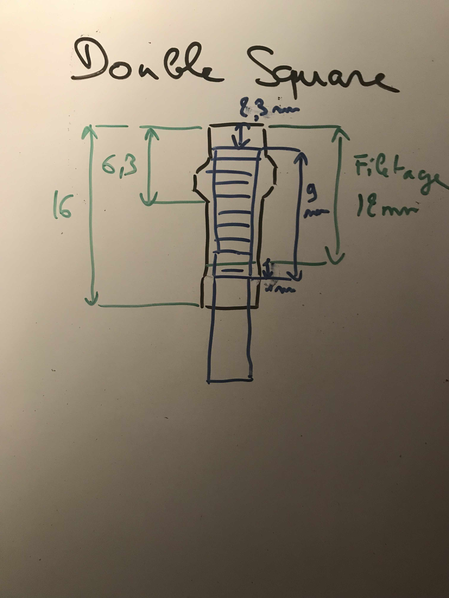{:.align-center :height="240px" width="240px"}

In this diagram, I have represented where the spoke will be housed in the nut when tensioned.
{: .text-justify}

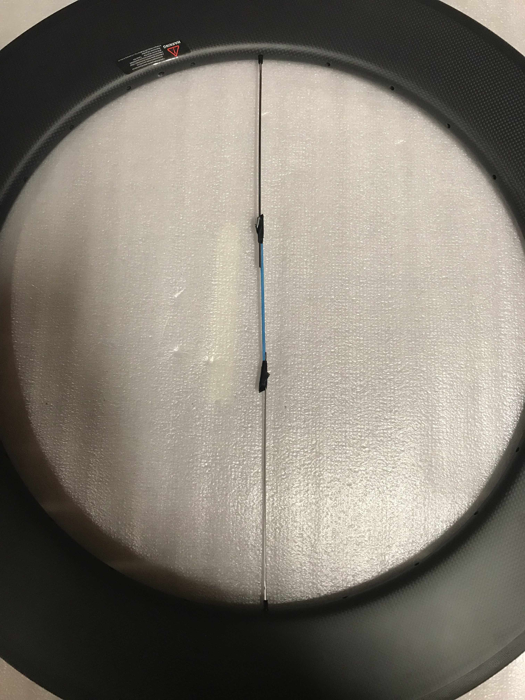{:.align-center :height="240px" width="240px"}

Once the spokes are fixed in the correct position with the nuts, just connect with a rubber band
and adhesive tape (see image below).
{: .text-justify}

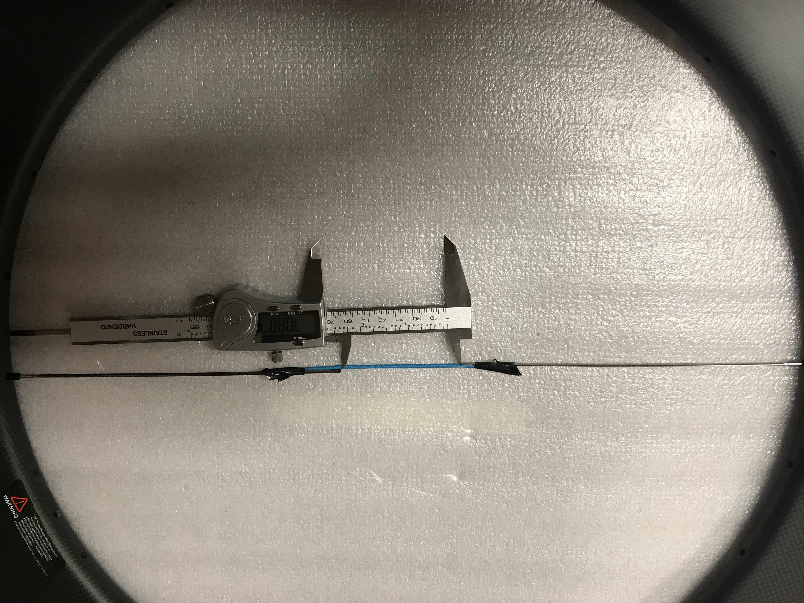{:.align-center :height="480px" width="480px"}

Finally, it remains only to take the measurement between the 2 ends of the spokes. Indeed, since the 2 spokes
  are 200mm.
 
- ERD = 200 x 2 + the measurement between the 2 ends.
- ERD = 200 x 2 + 71 = 471mm
{: .notice--primary}

Very far from the supplier's 464.5mm. And here is a first value that we can substitute in the equations
following.

### Hub measurement

  The diagram below represents the rear hub, I drew its center as a blue dotted line, which is where
  the rim will need to be aligned. We can see why the lengths of the spokes will not be the same for a
  rear wheel, since there is the cassette to take into account.
{: .text-justify}

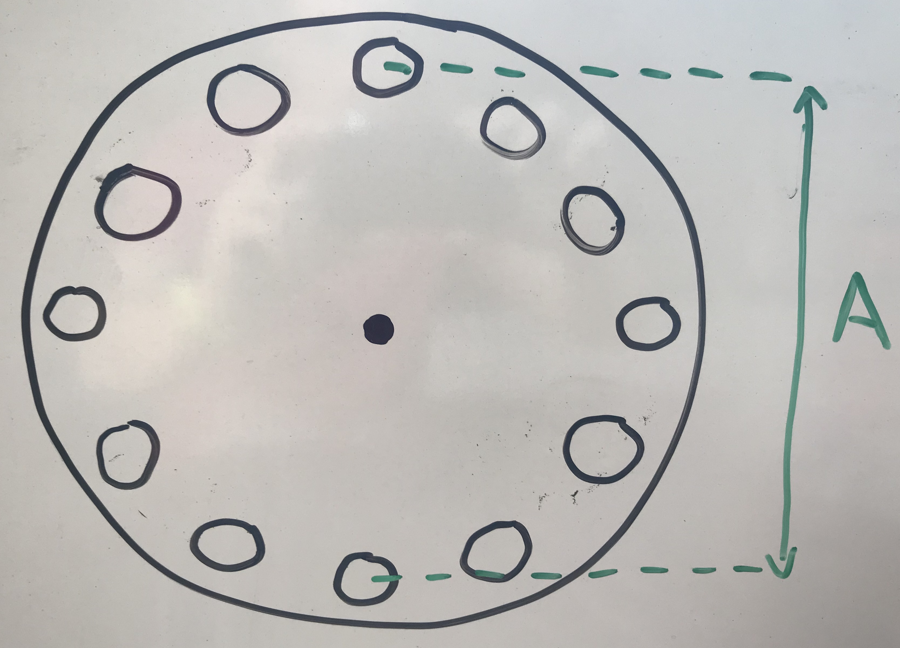{:height="320px" width="320px"}
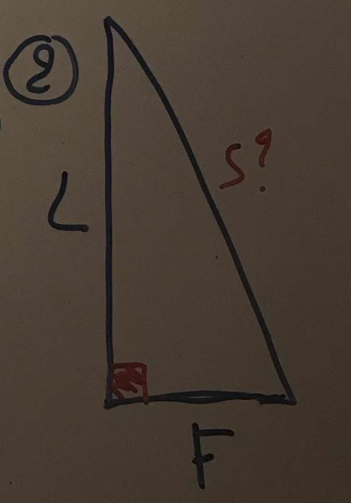{:height="320px" width="320px"}

a) The value of X is easy to determine, it is the width of the frame where the hub is installed
  (center distance).
This is a standard value for frames. On classic road bikes, this distance is often
130mm. This is a parameter to take into account before buying the hub. I had checked it before
to buy my hub (see chapter "choice of hub").
{: .text-justify}

b) The values we need to determine are C and D, which will be substituted
at H (see image)

H = C for the left side spokes and D for the right side spokes.

To get there, you have to measure "y" and "z". To do this, I used a piece of wood in which I made a hole big enough to
provide space for the hub end to rest on each side
{: .text-justify}

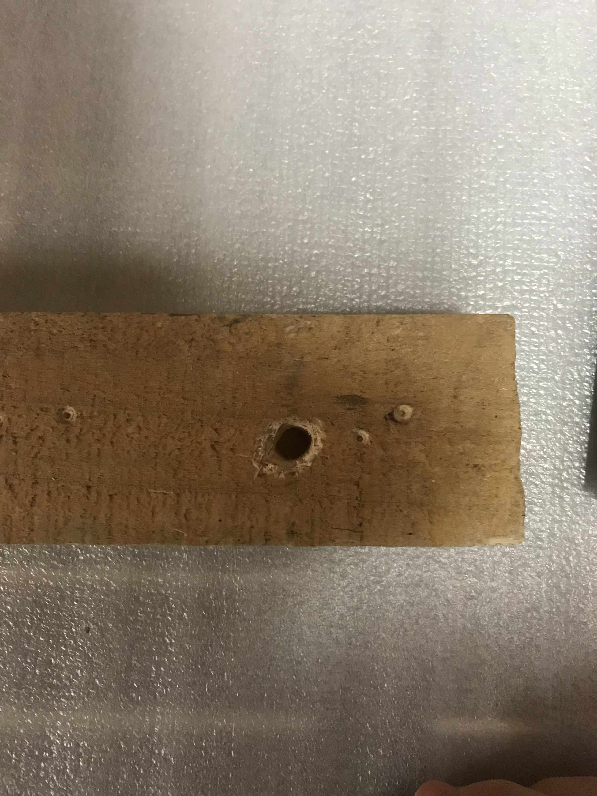{: .align-center :height="320px" width="320px"} 

Then I positioned the hub and took the measurements on each side using a square.

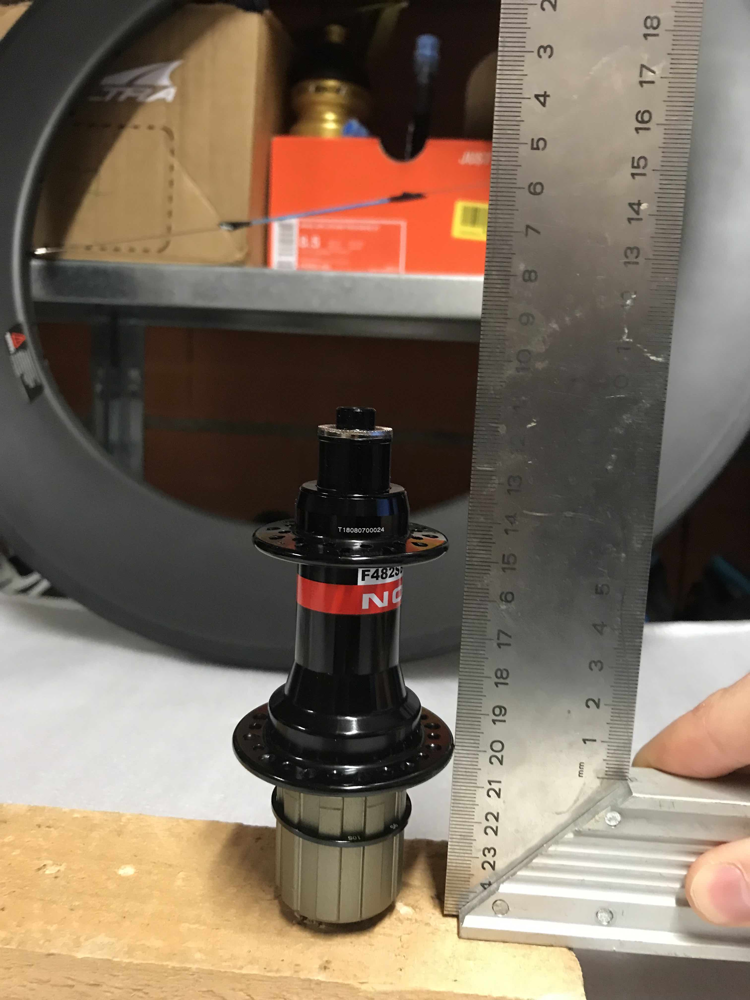{:height="240px" width="240px"} 
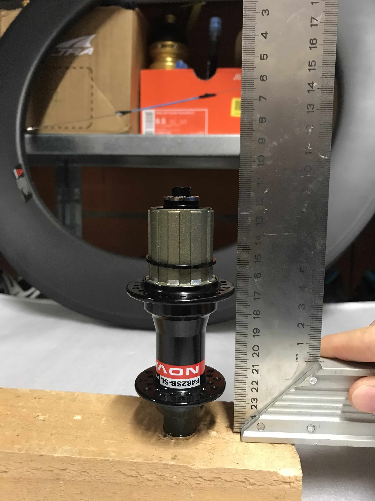{:height="240px" width="240px"} 

Here are the values.

$$
Y = 29mm \\
Z = 48mm
$$

Since the blue dotted line represents the middle of the hub X/2 we can deduce
the values of C and D.

$$
C = X / 2 - Y = 130/2 - 29 = \ boxed {36mm} \\
D = X / 2 - Z = 130/2 - 48 = \ boxed {17mm}
$$

c) Now I'm going to measure A and B to determine the value of H. And so H is neither more nor
less than A/2 and B/2. So to measure this diameter, I used 2 pieces of cardboard (see diagram below), as it is difficult to
use a caliper.
 {: .text-justify}

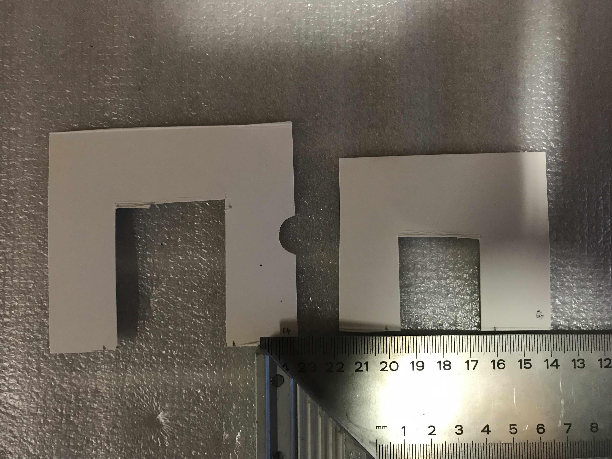{:height="480px" width="480px"} 

Then, just locate the center of 2 opposite holes on the flange and measure this
distance with a ruler.

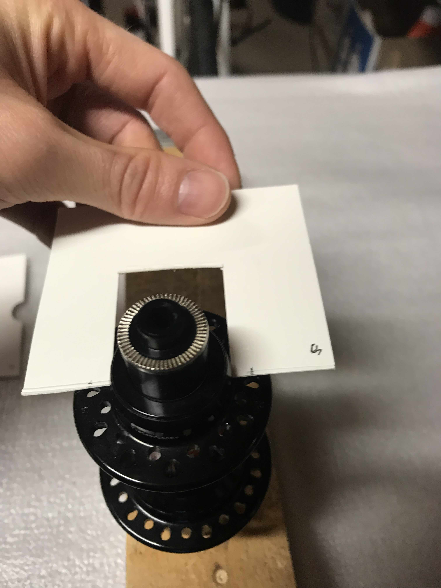{:height="240px" width="240px"} 
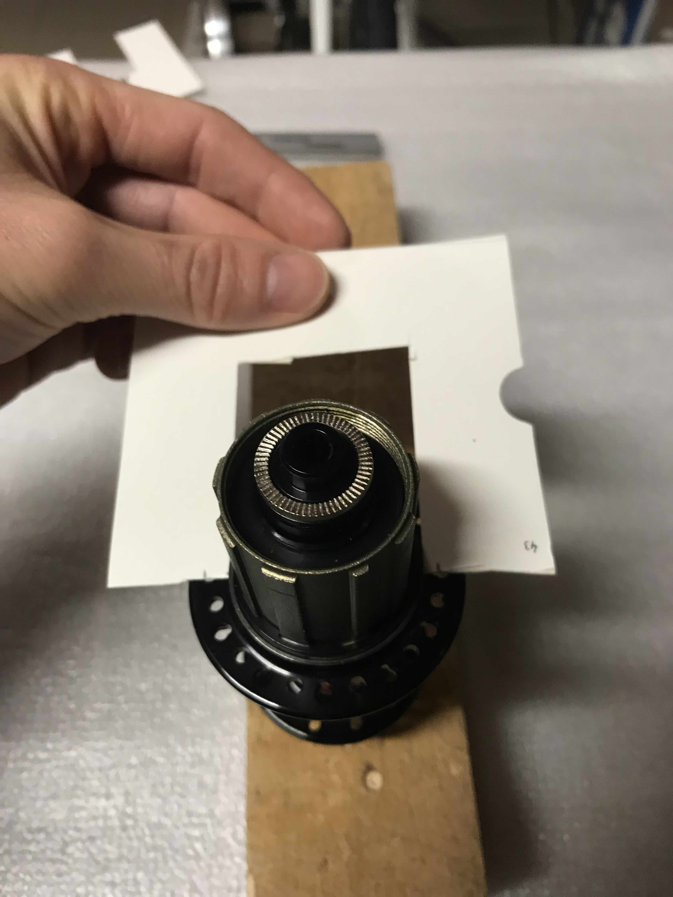{:height="240px" width="240px"} 

I get the following values:

$$
A = 41mm \\
B = 49mm
$$
for the left side
$$
H = A / 2 = 20.5
$$
for the right side
$$
H = B/2 = 24.5
$$

### Calculation of L

{:.align-center :height="320px" width="320px"}

So if we go back to triangle 1 HLR, we know H measured previously and the ERD too,
we will therefore be able to determine the value of L. The difficulty in this triangle is that it
is not a right triangle, so you cannot apply a simple Pythagorean theorem. But we can demonstrate
the law of cosines in a triangle with acute angles, using the Pythagorean theorem on a sub-triangle
right-angled, taking the foot of the height (see red line).
To apply these trigonometric laws, we need the value of the angle ϕ, and luckily we can
determine it! We know the number of holes in the rim (24), so the angle between each hole is 360 ° / 24 or 15 °.
Since I am going to lace with 2 crossings, each spoke will be offset by 4 holes. I
will detail all this in the chapter dedicated to lacing.
{: .text-justify}

[Cosine law](https://fr.wikipedia.org/wiki/Loi_des_cosinus)

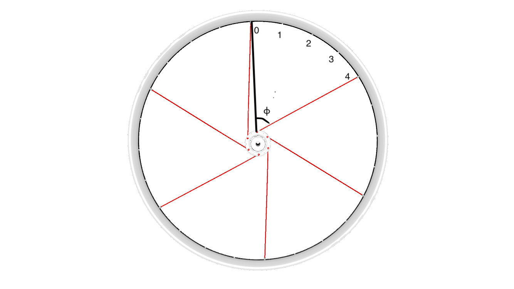{:.align-center :height="320px" width="320px"}

We get an angle 15 ° x 4 = 60 °.

Now I have everything I need to apply the cosine law and get the value of L.

{:.align-center :height="480px" width="480px"}

$$
R = ERD/2 \\
R2 = R - R1 \\
$$

To determine R1 we can easily apply the following trigonometric law:

$$
cos\varphi =\frac{R1}{H} \\
R1 = Hcos\varphi
$$

So by substitution we get

$$
R2 = R -  Hcos\varphi
$$

Finally, for the height H' in red, we can use the following trigonometric relation:

$$
H'= H sin \varphi
$$

We have everything we need to apply Pythagoras' theorem on the triangle H'LR2

$$
L^2 = H'^2 + R2^2 \\
L^2 = (H sin \varphi)^2 + (R -  Hcos\varphi)^2 \\
$$

We now have everything we need. I will factor this equation to simplify
calculations that follow.

You can easily recognize the well-known identity $$ (a - b) ^ 2 $$

$$
L^2 = (H sin \varphi)^2 +  \underbrace { \color{Red} {(R - Hcos\varphi)^2} }_{(a - b)^2 = a^2 -2ab + b^2}     \\
$$

So we can write

$$
L^2 = (H sin \varphi)^2 + R^2 - 2RHcos\varphi + (Hcos\varphi)^2 \\
$$

A small factorization allows us to apply another well-known identity $$sin \varphi^2 + cos \varphi^2 = 1$$

$$
L^2 = H^2 \underbrace { \color{Red} {(sin \varphi^2 + cos \varphi^2)}}_{sin \varphi^2 + cos \varphi^2 = 1} + R^2 - 2RHcos\varphi \\
$$

We get a more readable equation.

$$
\boxed{
L^2 = H^2 + R^2 - 2RHcos\varphi
}
$$

### Calculation of S

Now, thanks to the value of L, we can apply a simple Pythagorean theorem to the triangle LSF, so
to determine S.

{:.align-center :height="320px" width="320px"}

Pythagorean theorem on LSF with S as hypotenuse.
[Pythagorean Theorem](https://fr.wikipedia.org/wiki/Théorème_de_Pythagore)

$$
S^2 = F^2 + L^2
$$

I substitute the value of $$L^2$$, obtained previously

$$
S^2 = F^2 + H^2 + R^2 - 2RHcos\varphi
$$

We get an equation that we can solve.

$$
\boxed{
S = \sqrt{F^2 + H^2 + R^2 - 2RHcos\varphi}
}
$$

#### Calculation of S for the left rays

I take the values previously measured

$$
H = A/2 = 41/2 = 20.5mm \\
F = 36mm \\
R = ERD/2 = 471/2= 235.5mm \\
\varphi = 60°
$$

I replace the variables with the values

$$
S = \sqrt{36^2 + 20.5^2 + 235.5^2 - 2*235.5*20.5cos(60°)} \\
S = \sqrt{1296 + 420.25 + 55460.25 - 9655.5*cos(60°)} \\
S = \sqrt{57176.5 - 9655.5*0.5} \\
S = \sqrt{57176.5 - 4827.75} \\
S = \sqrt{52348.75} \\
\boxed{
S = 228.798mm
}
$$

#### Calculation of S for the right rays

$$
H = B/2 = 49/2 = 24.5mm \\
F = 17mm \\
R = ERD/2 = 471/2= 235.5mm \\
\varphi = 60°
$$

I replace the variables with the values

$$
S = \sqrt{17^2 + 24.5^2 + 235.5^2 - 2*235.5*24.5cos(60°)} \\
S = \sqrt{289 + 600.25 + 55460.25 - 11539.5*cos(60°)} \\
S = \sqrt{56349.5 - 11539.5*0.5} \\
S = \sqrt{56349.5 - 5769.75} \\
S = \sqrt{50579.75} \\
\boxed{
S = 224.899mm
}
$$

### Adjustment 1

On the diagram below I represent how the spoke will be lodged in the hole of the hub. For all the previous calculations, I took the measurements at the center of the hub hole, especially for the measurement of A and B. But
if we take the documentation of the SAPIM CX-Ray spokes, the length of the spoke starts from the inside of the elbow. So
it is necessary to remove the spoke from the hole of the hub to obtain the real size of the spoke (in green on the diagram).
{: .text-justify}

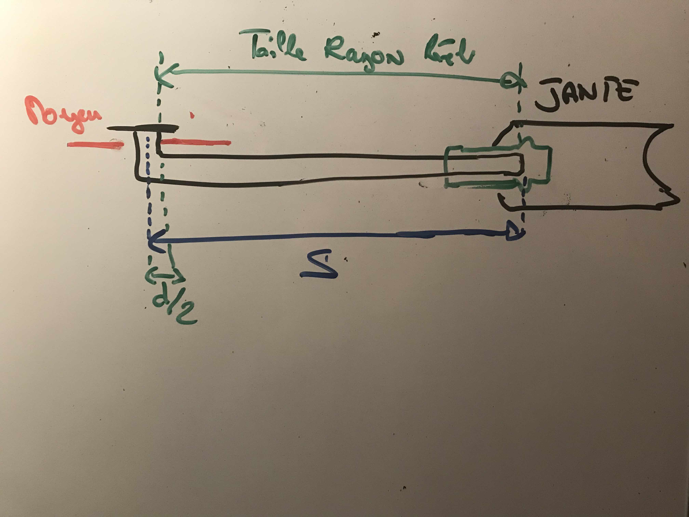{:.align-center :height="480px" width="480px"} 

Using the caliper, I get a diameter of d=2.6mm, so the radius is

$$
r = d/2 = 2.6/2 = 1.3mm
$$

It is enough to subtract this value from the spoke length previously calculated.

Left side

$$
S = 228.798 - 1.3
$$

$$
\boxed{
S = 227.498mm
}
$$

Right side

$$
S = 224.899 - 1.3
$$

$$
\boxed{
S = 223.599mm
}
$$

We can update the formula like this:

$$
\boxed{
S = \sqrt{F^2 + H^2 + R^2 - 2RHcos\varphi} - r
}
$$

### Adjustment 2

Now that I have the theoretical values, I will adjust the formula taking into account
the physical forces that act on it. Indeed, spokes under tension will stretch,
only a little, but it can change the choice between 2 spoke sizes. So, to
calculate the elongation of the spoke I will use the [Hooke's Law](https://fr.wikipedia.org/wiki/Loi_de_Hooke).
{: .text-justify}

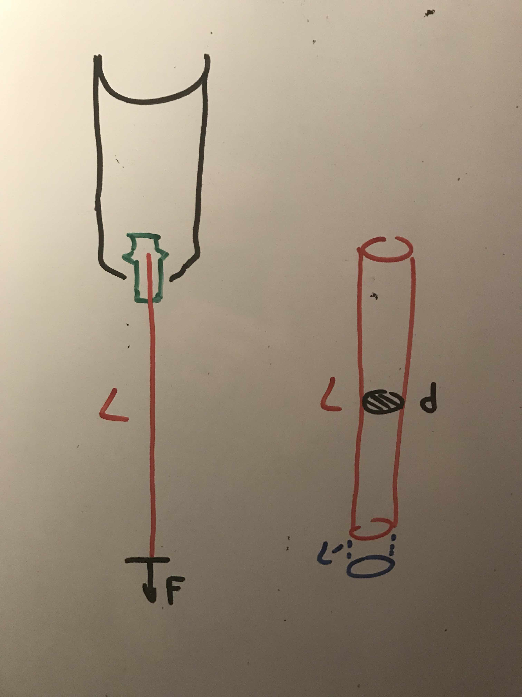{:.align-center :height="480px" width="480px"}

Hooke's law applied to a cylinder

$$
L'/L = 1/E * F/A \\
L' = F/A * L/E
$$

With

- E = Modulus of Elasticity of steel see [Young's modulus](https://fr.wikipedia.org/wiki/Module_de_Young)

Or 210 GPa

- L = Length of the spoke previously calculated
- L Left = 227.498mm = 0.227498m
- L Right = 223.599mm = 0.223599m

- F = Force = Mass * Acceleration = m * a

Maximum mass = 100kg

$$
\boxed{
Acceleration = 9.81m/s^2
}
$$

- A = The area of the section $$ π * R^2 $$
- R is the radius of the spoke before it is forged. Indeed, SAPIM CX-Ray spokes are cylindrical at the ends
and flat in the middle. But before being transformed, the spoke was fully cylindrical. So we have to do some research
or ask the supplier directly for this information. So the SAPIM
CX-RAY is 1.5mm in diameter before being forged.

Is

$$
R=d/2=1.5/2=0.075mm=0.000075m
$$

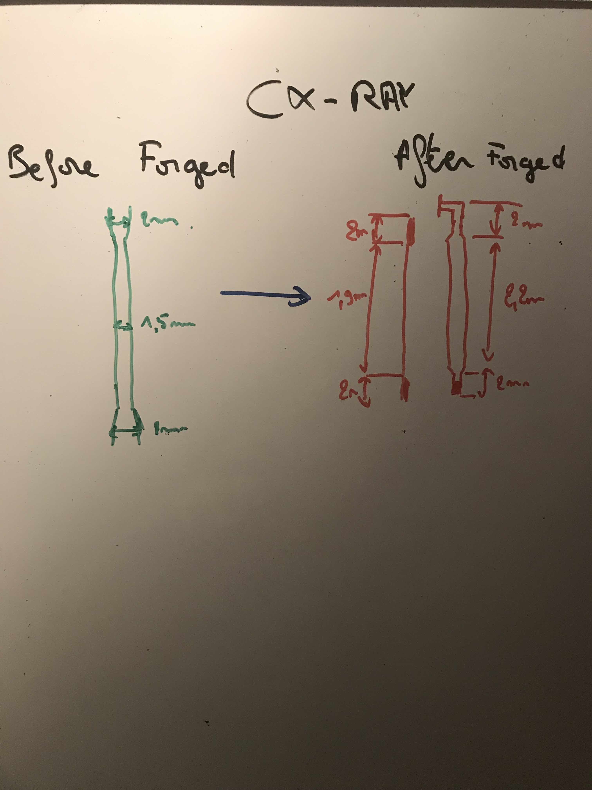{:.align-center :height="480px" width="480px"}

$$
E = 210 GPa = 210e^9 \\
A = π * R^2 = π * 0.00075^2 = 1.76e^6m^2
F = 981N
$$

Left side:

$$
L' = 981/1.76e^-6 * 0.227498/210e^9
L' = 0.000601m=0.601mm
$$

Real length of the spoke before being stretched:

$$
227.498 - 0.601 = \boxed{226.897mm}
$$

Right side:

$$
L' = 981/1.76e^-6 * 0.223599/210e^9
L' = 0.000591m=0.591mm
$$

Real length of the spoke before being stretched:

$$
223.599 - 0.591 = \boxed{222.999mm}
$$

The final formula becomes:

$$
\boxed{
S = \sqrt{F^2 + H^2 + R^2 - 2RHcos\varphi} - r - L'
}
$$

 
### Results

Here I finally have all the elements to order my spokes.

I get 226.897mm for the left side and 222.999mm for the right side.
But when we order the spokes, the available sizes go from 130-310mm in even numbers.
So you can buy 220mm, 222mm, 224mm, 226mm... The choice depends on the results obtained.
It is quite simple: do not exceed a gap of more than 1mm, otherwise it could make
mounting difficult.
{: .text-justify}

So I ordered 12 spokes 226mm for the left side and 12 spokes 222mm for the right side.
 
# Mounting

Now that I have the spokes, the nuts, the hub and the rim, I have everything I need to start
mounting. Finally, I still lack some tools. I invested in tools that will pay off quickly.
{: .text-justify}

## Tools

### Wheel centering device

The wheel centering tool will allow the wheel to be trued during tensioning, until a true wheel is obtained.
This tool will be very useful for maintaining its wheels throughout its life cycle. Every cyclist should have one
at home to watch these wheels from time to time, too many people ride on wheels that are out of true ...
{: .text-justify}

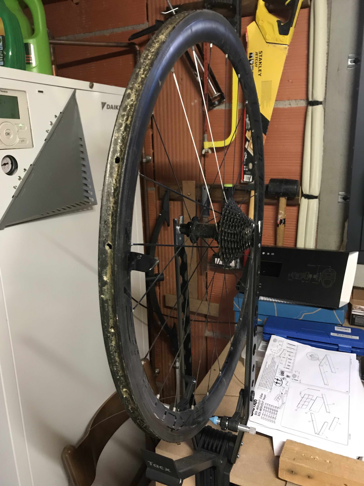{:.align-center :height="240px" width="240px"} 

### A centering gauge or alignment comparator

This tool is very important, it will make it possible to verify that the hub is properly aligned with the rim. I will use it
as for wheel centering, throughout the tensioning.
{: .text-justify}

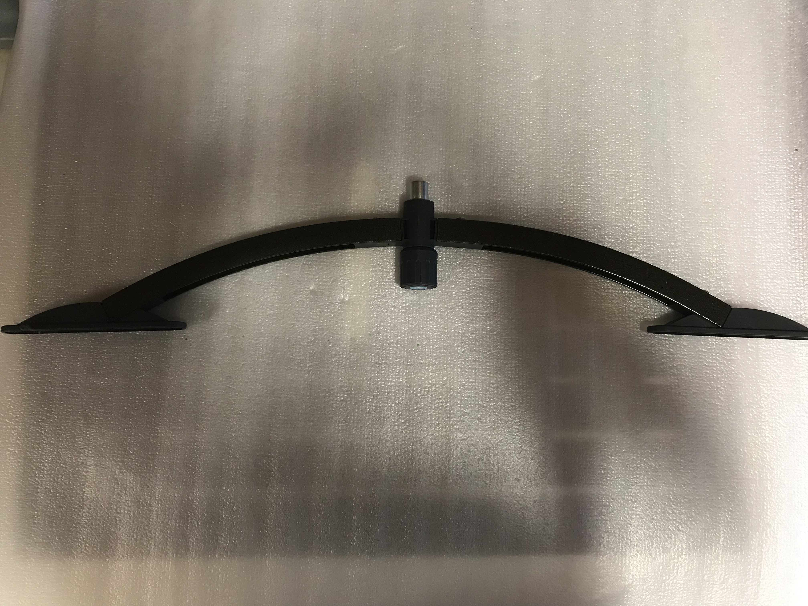{:.align-center :height="240px" width="240px"} 

### A screwdriver with nuts (hexagonal head)

My choice of Double Square nuts from Sapim was mainly for their hexagonal head which allowed me to use
this type of screwdriver which is long enough to work on rims over 80mm high. There are several types of
nut head, size and therefore different types of screwdrivers. There are also brands that have their own standard
like Dt-Swiss, which requires buying their nuts and using their tools.
{: .text-justify}

{:.align-center :height="240px" width="240px"} 

### Holding key for flat spoke

This tool is specific to the flat spoke, it keeps the spoke in the right direction during tightening
of the nut.
{: .text-justify}

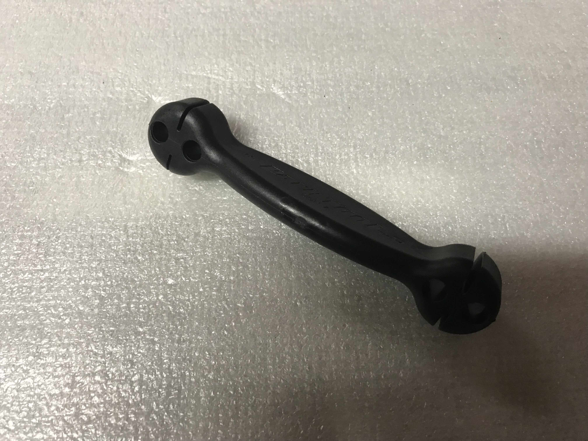{:.align-center :height="240px" width="240px"}

### Spoke wrench

Unlike the screwdriver, which tightens the spoke from inside the rim, the spoke wrench
lets you adjust the spoke tension directly from the outer head, which is useful when the tubular
is installed. The only downside is that the tool damages the paint of the colored spokes.
{: .text-justify}

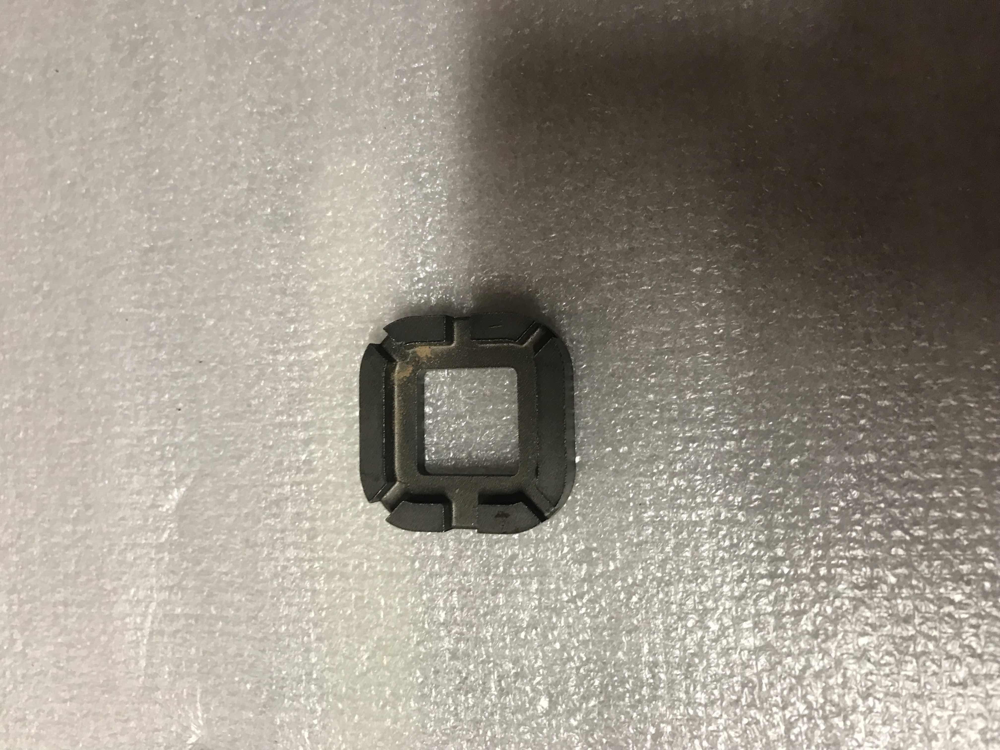{:.align-center :height="240px" width="240px"}

### Tape

The adhesive tape will be very useful for putting marks on the spokes while the wheel is being trued.
{: .text-justify}

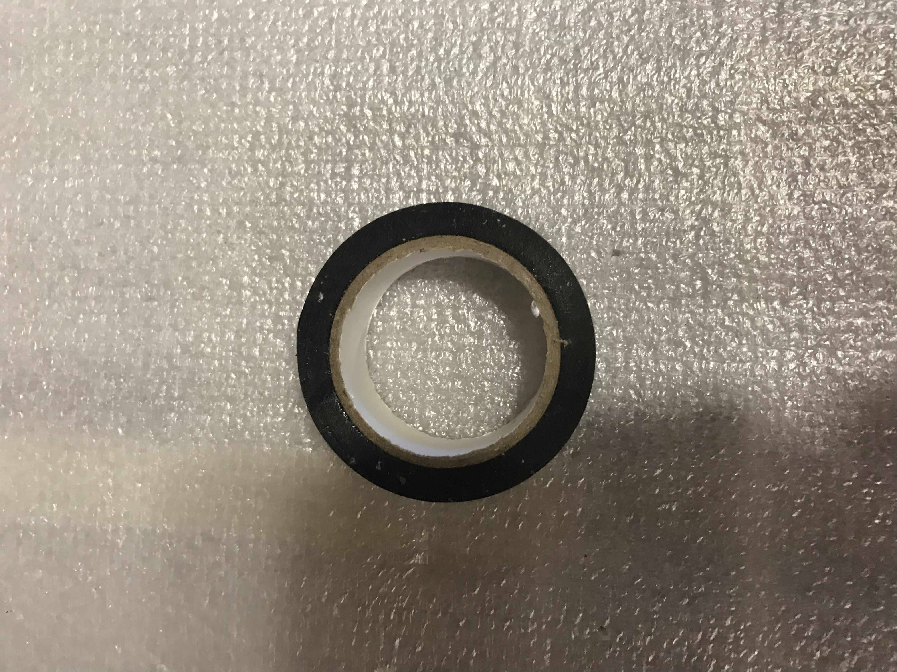{:.align-center :height="240px" width="240px"} 

### Spoke tension meter

The spoke tension meter will allow you to check the correct tension on all the spokes.
{: .text-justify}

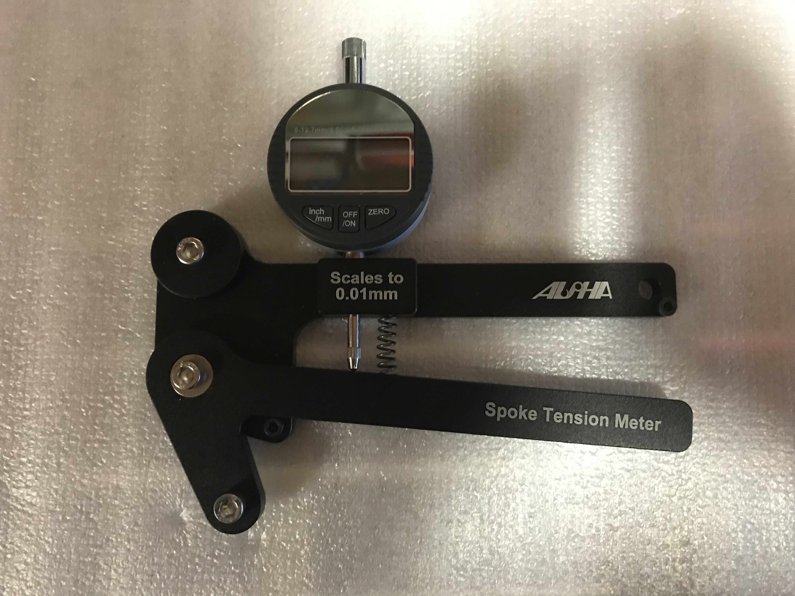{:.align-center :height="240px" width="240px"} 

### Costs

| Description | Price |
|---------------------------------------------|:-------:|
| Tacx wheel centering device | 47.90 |
| A Tacx centering gauge | 34.99 |
| Park Tool Nut Driver | 12.85 |
| Park Tool Flat Spoke Holding Key | 13.83 |
| Spoke wrench | 6.90 |
| Adhesive tape | 0.96 |
| Spoke tension meter | 45.79 |
| Total | 163.22 |

## Lacing

Everything is described in the literature and there are lots of videos on YouTube to help understand
, but the best is this application [Rad 3D](https://appadvice.com/app/rad-3d/1103912788) that I came across.
It allows you to have a 360 ° view according to the number of spokes and crossings that you wish to make. We can
break down each step and look at it from all angles. I will detail the steps for my type of
mounting. In fact, there are several ways of lacing:

- Radial: the spokes do not cross. We find this type of mounting on the front wheels, but sometimes on the left side
of the rear hub, which is only of interest for aesthetics. In addition, a radial mounting weakens the
wheel especially when braking. On my 38mm wheels, at the rear, there are 8 radial spokes on the left and 16
spokes with 2 crossings on the right. I understand why my wheel wobbles when I sprint out of the saddle. Indeed, the 8
radial spokes are the cause of this imbalance.

There are 3 other types of lacing:
- A: Symmetrical lacing on the left and right side (cassette). Spokes leaving the hub on the outside
cross the spokes leaving from the inside, passing below.
- B: Another symmetrical lacing does the opposite of the above.

These 2 types of lacing make no difference in terms of performance. However, they have a slight difference when braking
especially if you have disc brakes. Indeed, during braking, the spokes will pull with the first type
lacing, the spokes will be pulled inward, while in the other case they are pulled outward, which could
touch the brake disc. The other difference is that, conversely, when pedaling, type A lacing will pull
outwards, which could touch the cassette... From what I have read, there is usually
enough space not to touch the cassette or disc.
{: .text-justify}

- Finally, there is a specific Shimano assembly for disc brakes on rear wheels that we can
find on the internet.

So I chose to do type A lacing.

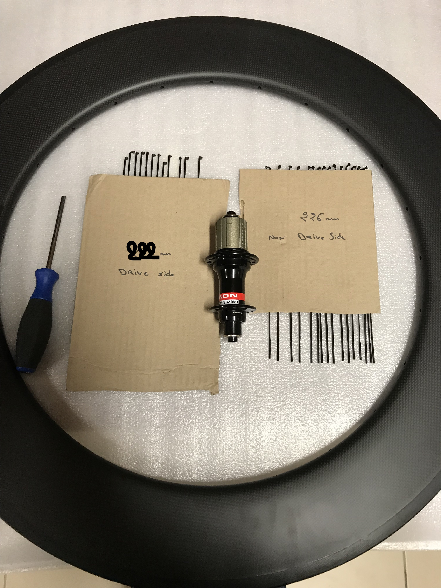{: .align-center :height="320px" width="320px"}

### Step 1: 

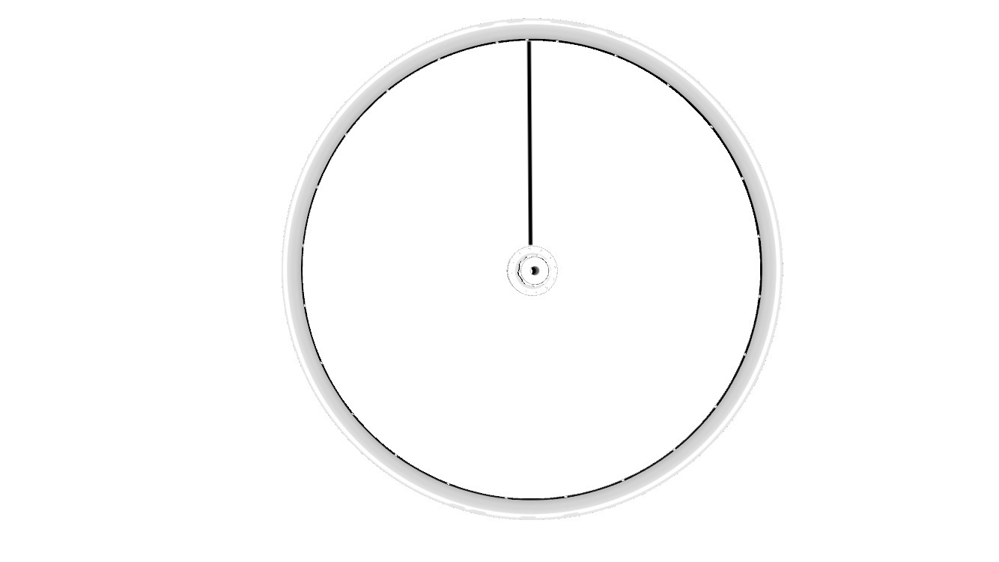{: .align-left :height="320px" width="320px"}
With the cassette side of the hub in front of me and the valve mark aligned perpendicularly, for a well-finished wheel
the best thing is to have the hub logo aligned with the valve. To get there, just think of the angle the spokes
take when lacing; we will see it in the next step. The technique is just to take the middle
of the hub logo and count 3 holes to the left, we will see later why 3. Simply put, when lacing
with 2 crossings, it will fall right in front of the valve.

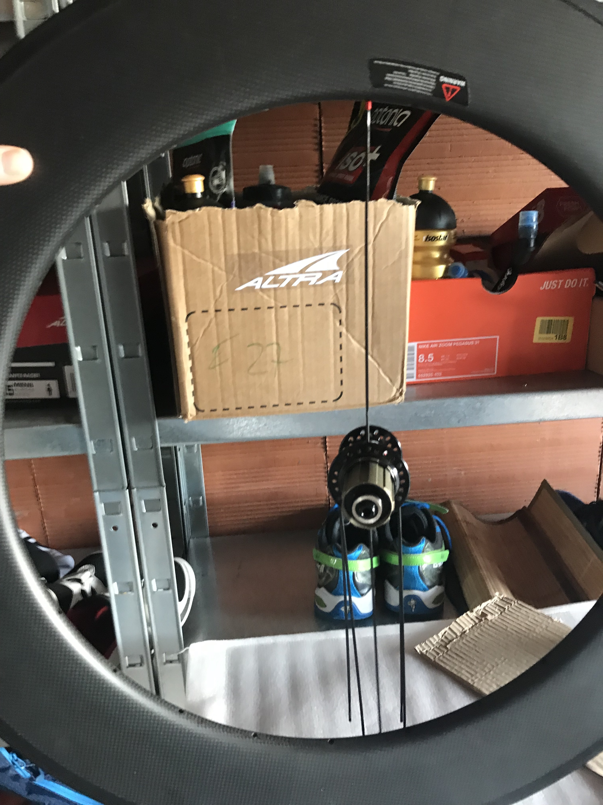{:height="240px" width="240px"}
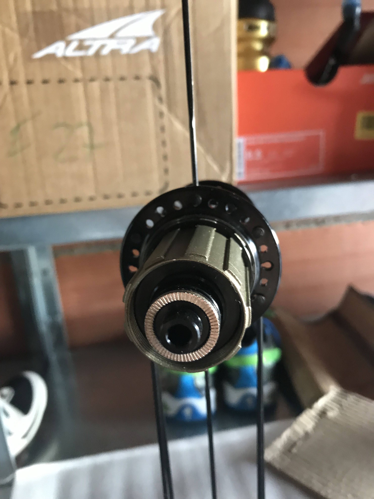{:height="240px" width="240px"}

-------
### Step 2: 

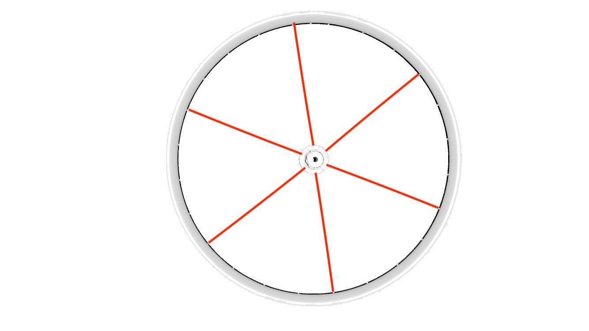{: .align-left :height="320px" width="320px"}
I start on the cassette side, so I take the right spokes. Be sure to separate them well so as not to mix them up...
From this stage, you have to take your time. So I take 6 spokes of 222mm (cassette side) and I start from
center of the hub, coming in from the outside and I insert the spoke in the first hole to the left of the valve. I take
a nut and tighten it slightly, just enough so that it stands on its own. Then I alternate every 2 holes on the hub side
and all 4 holes on the rim side.

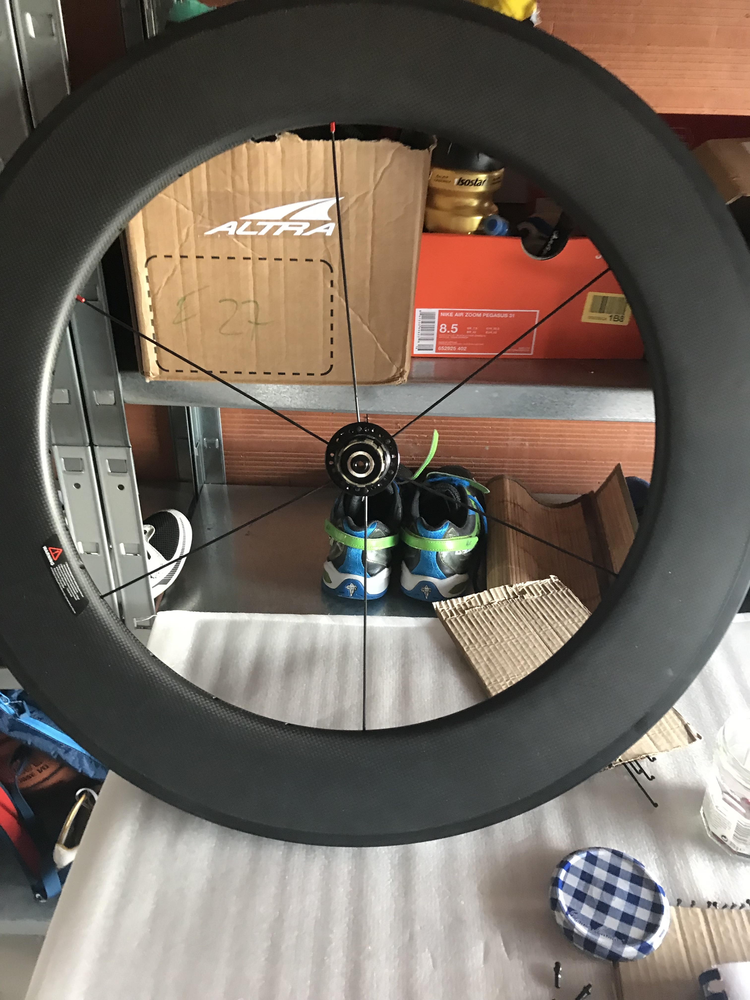{: .align-center :height="320px" width="320px"}

-------
### Step 3: 

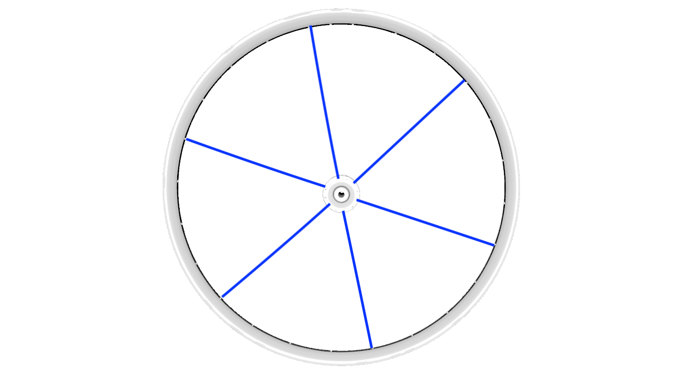{: .align-left :height="320px" width="320px"} 
I did not display the spokes in step 2 for better readability. We turn the rim and do the same operation, but in
taking the 226mm spokes (left side). I used nuts of different colors just for style, so
  to get an alternation, I used reds
cassette side and blacks, left side. In addition, it helped me as a reference when truing.

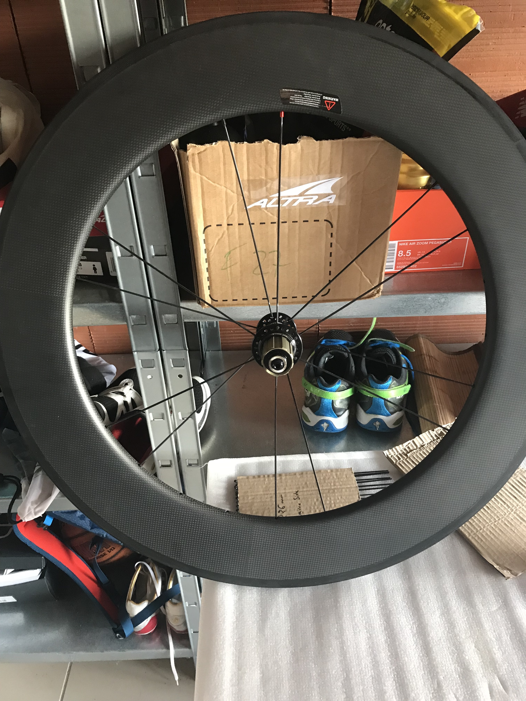{: .align-center :height="320px" width="320px"}

-------
### Step 4: 

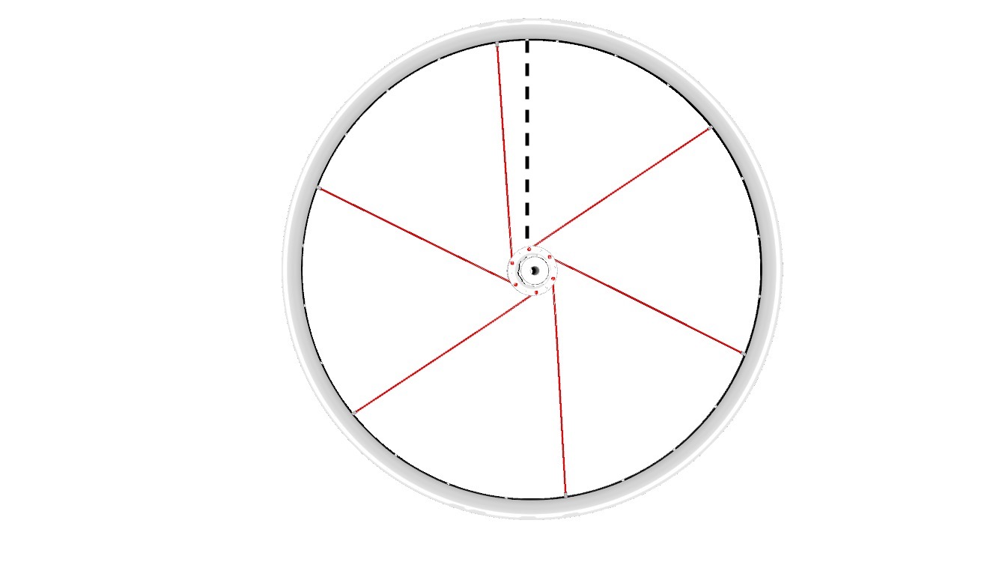{: .align-left :height="320px" width="320px"} As before 
I omitted the spokes on the other side for better readability.
I take the hub on the cassette side and turn it counterclockwise until it
stops. The desired angle is reached in all the previous calculations. And it is with this rotation that we will re-center the logo
of the hub in front of the valve. We understand why I shifted the hub in step 1.

-------
### Step 5: 

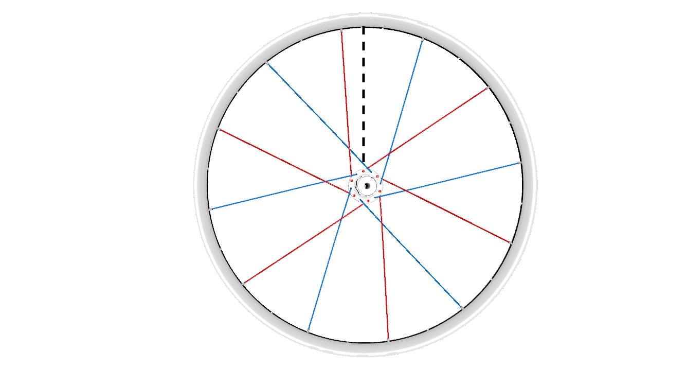{: .align-left :height="320px" width="320px"}
I only display the spokes on the cassette side to make it easier to read. So I take again 6 spokes of 222mm
(cassette side) and I insert the spokes into the remaining holes, but this
time I'm going to go inside, then make a crossing by passing below the adjacent spoke to
reach (see diagram below). The spoke must join the hole in the rim as in the diagram opposite.
Now do not hesitate to bend the spoke to reach the hole. Finally, it is always the same: you just have to
tighten enough for the spoke to hold.

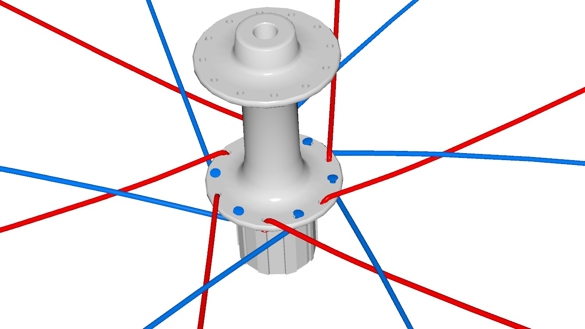{: .align-center :height="320px" width="320px"}

Here is the result if I display the spokes on both sides.

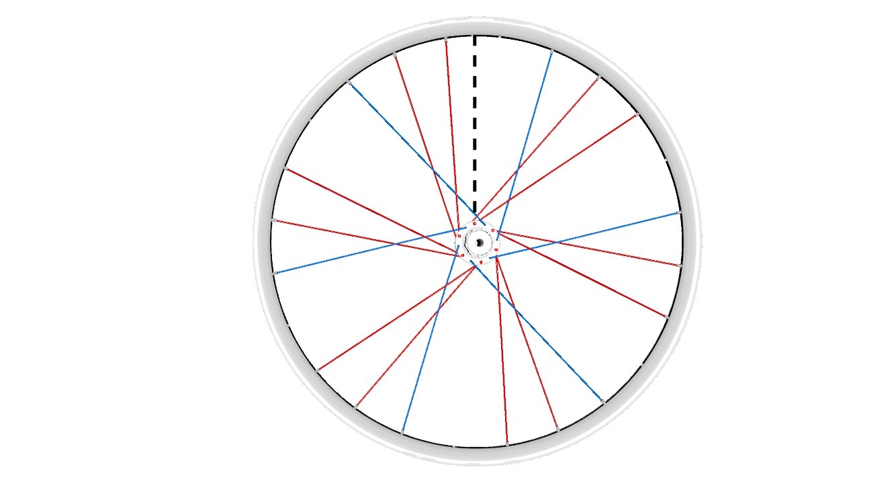{: .align-center :height="320px" width="320px"}

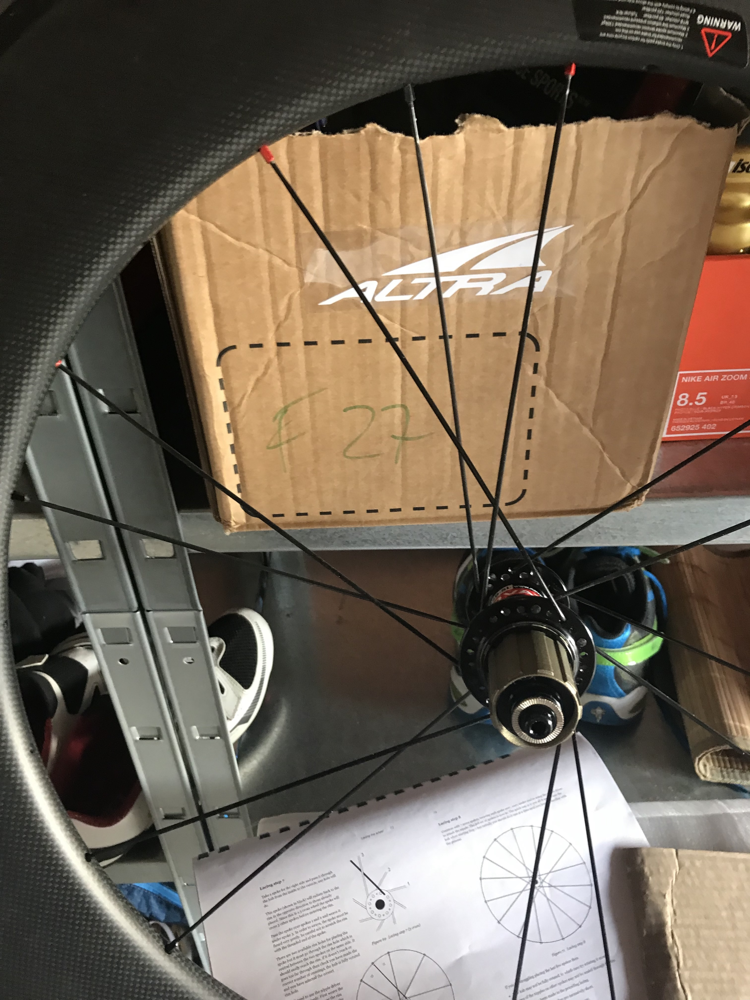{: .align-center :height="320px" width="320px"}

-------
### Step 6: 

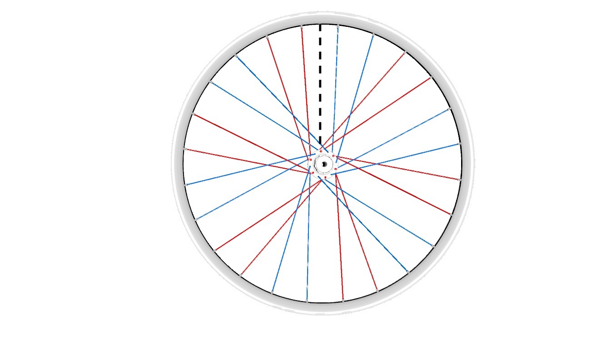{: .align-left :height="320px" width="320px"}
Now just put the last 6 spokes in the same way, but on the left side. Here is the
wheel fully laced on each side.

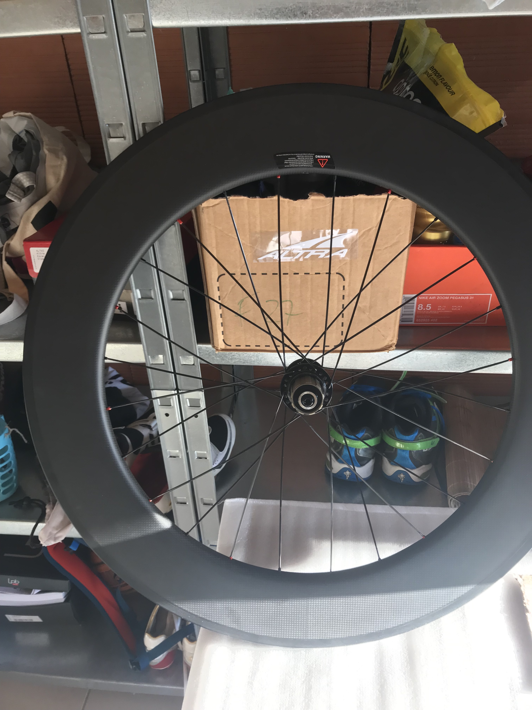{: .align-center :height="320px" width="320px"}

    
## Power on and de-veiling

The wheel is ready to be trued and tensioned. I install the wheel on the centering device
and off we go. For this part, I once again take my time, because I have no experience
in this area unlike a professional who can do this very quickly. It's a knack
that you learn by doing it. I had to start over several times before arriving at the final result, but we learn from our
mistakes, as they say. So it took me several hours to get there, but it was worth it.
{: .text-justify}

{: .align-center :height="320px" width="320px"}

### Step 1

I first tightened all the spokes to the same level, using the thread of the spoke as a reference. I have
screwed each spoke until the thread is no longer visible.
{: .text-justify}

### Step 2

Using the alignment gauge, I check the state of my alignment. For now it is completely off, which is
normal. But we can see that it will bring the hub back to the center of the rim. For this, we will have to tighten more
the spokes on one side. So, to put it simply, if I tighten the spokes on the cassette side, this will bring the rim back to the
right (when tightening the spokes, it is the rim that moves and not the hub), and vice versa if I tighten from the left. So, depending on the state of the alignment, you have to adjust the left and right spokes. So,
I tighten each spoke on the right by 2 turns of the screwdriver, and each spoke on the left by 1 turn. You have to know
that the further we advance in the tensioning, the more we need to limit the number of turns, until we make quarter turns
for the last adjustments. If we don't do it gradually, it will be impossible to true the wheel
in the following steps.
{: .text-justify}

### Step 3

I tightened my spokes on the 2 sides in a balanced way to reach an almost correct alignment; there is a 2mm
error which is normal at this stage. But it is not worth continuing if the error is greater, because more
the spokes are under tension, the harder it will be to correct an alignment error. So I checked
alignment frequently throughout tensioning. The target alignment is shown in the diagram
below.
{: .text-justify}

{: .align-center :height="320px" width="320px"}

Here are some interesting links:

[Alignment gauge](https://www.youtube.com/watch?v=Vnkqy2nnsrY)

### Step 4

The wheel now has a correct alignment, so I can continue tensioning. In this step, I am going to
true the wheel. With the centering device it is quite simple, but you have to take your time. I used
adhesive tape to mark the spokes that cause problems. Then, as I said before, if I want to
bring my rim to the right, I tighten the spokes attached to the right part of the hub, and vice versa for
   the other side. This also means that at this stage, you may have to loosen a certain spoke.
I do quarter turns and look at the result and iterate until I get a true wheel. We can feel
if some spokes are less taut than others, you have to try to get a uniform tension. You can do this
easily by touch, just by pressing on the spokes.
{: .text-justify}

[Truing a wheel](https://www.youtube.com/watch?v=gJgH63gQmrE)

### Step 5

The wheel is trued and aligned, so it is now time to finish the tensioning. I do quarter turns on
all the spokes while checking to keep the alignment and not making the wheel go out of true. I feel my wheel is starting to be
good. Just by touch, you can tell they are right. It is normal for the spokes on the right side to be more tense than the
left by the geometry of the hub. It is especially important that the tension on the cassette side is good on all
the spokes, because this is the side where the forces are the most stressed. I finally use a spoke tension meter
to check that I have an equivalent tension for all the spokes on each side. For the tension level
there are several schools. Some people just use touch or sound, by pinching the spokes, and others use the
tension value. I admit that the touch method is enough, because too-tight spokes will not bring
any more rigidity and, on the contrary, will tire the spoke more quickly. Obviously, a spoke that is not tight enough will also have
 consequences on the longevity of the spokes and resistance to the weight of the cyclist and to the constraints of the road.
 So you have to find the right compromise. I relied on touch and then checked with the spoke tension meter to see what it was worth.
But I did not set the exact tension indicated for my weight.
{: .text-justify}

## Assembly

The bare wheel is ready. It is now possible to assemble the elements so that it can
join the road and attach it to the frame of the bike. I'm not going to detail what I did,
because it would be "reinventing the wheel", here are some YouTube videos showing what I did.
{: .text-justify}

### Installation of the valve extension.

[Valve extender](https://www.youtube.com/watch?v=EbA5ZBZa5IQ)

{:height="200px" width="200px"}
{:height="200px" width="200px"}
{:height="200px" width="200px"} 

- A small key is often delivered with the valve extenders to remove the valve core easily
- There are anti-vibrators to stick on so that the valve does not vibrate on the rim while driving. Indeed,
unlike an inner tube valve, which does not move when pressurized, on a tubular it is different:
the more rigid tubular does not allow this. Miche valve extenders directly contain their anti-vibrators
which are excellent. Otherwise, you can just put on a simple adhesive tape, but it is less aesthetic.
{: .notice--primary}

### Gluing the hose

[Gluing a tubular](https://www.youtube.com/watch?v=R7_9_BGsdGo)

- I have an old rim that I picked up at a recycling center, which I mainly use to stretch
my tubulars before gluing.
- I sand the rim to remove the old glue or when the rim is new to make it a little rough
so that the glue sticks more easily.
- I use gasoline F to clean my rim to remove all the excess glue residue.
{: .notice--primary}

### Cassette

[Installation of a cassette](https://www.youtube.com/watch?v=9KAaP7pbFV0)

 {: .align-center: height = "320px" width = "320px"}

- I take advantage of the change of cassette to properly clean and degrease it.
{: .notice--primary}

## Pressurization

It is time to inflate the tubular. I usually run 9-10 bar. It all depends on the limit indicated by the brand
and what is recommended by the rim. But the more pressure we can use, the less grip the tubular has
on the ground, so less friction and more speed for the same effort. The only compromise is that
the more pressure you have, the more comfort you lose, because the slightest shock is passed on to the cyclist. With lower
pressure, the shock is better absorbed by the tubular. Again, it is a compromise.
{: .text-justify}

## Quick hitch

For quick couplers, I did not buy new ones. I use the same ones for all my wheels, and it is not
a hassle to swap them. It is still important to have a good pair of quick couplers, especially in terms of
lightness, because it is easy to weigh down the wheel by buying low-end ones. It would be a shame to lose
grams gained on the hub and rim ...
{: .text-justify}

## Brake pad

Since on a tubular rim the braking is done directly on the tubular, unlike on rims
for tires, where an aluminum braking track is added. So you need special brake pads. I use SwissStop Flash
Pro that works on all types of rims, which is handy when I put my wheels on tires.

## First test and adjustments

Since I opted for a 25mm wide wheel, I need to move my brake caliper aside a bit so that my
wheel can pass. My caliper is compatible with rims up to 28mm, so there is no problem, but it can be checked before
buying. It is quite easy with an Allen key, and it is quickly sorted. I install the wheel without any problem, and here is the
result in the image below.
{: .text-justify}



The bike is ready for the road test, let's go! The proof is in the pictures!



# Summary of costs
A rear wheel costs more: more spokes, a more expensive hub, and a cassette.

### Bare wheel

| Description | Weight | Quantity | Unit Price. | Total Price | Total Weight |
|:-------------------------------------------:|:-------:|:---------:|:----------:|:-----------:|:----------:|
| Carbon rim H=88mm L=25mm;24 Holes; Tubular | 525g | 1 | 103.67 | 103.67 | 525g |
| Novatec FS482SB 24 Hole Hub | 228g | 1 | 59.98 | 59.98 | 228g |
| Spokes Sapim CX-Ray Black | 4g | 24 | 2.20 | 52.8 | 96g |
| Sapim Double Square Red Nuts | 0.4g | 24 | 0.30 | 7.2 | 9.6g |
| Total | | | | 223.65 | 859g |

### Accessories

| Description | Weight | Quantity | Unit Price. | Total Price | Total Weight |
|:-------------------------------------------:|:-------:|:---------:|:----------:|:-----------:|:----------:|
| Vittoria CX 25c 320TPI tubular | 250g | 1 | 34.99 | 34.99 | 250g |
| Extender Miche 70mm red (sold by 2) | 10g | 1 | 16.99 | 16.99 | 10g |
| Quick coupler Mavic Rear Axle 9mm 130mm | 50g | 1 | 25.00 | 25.00 | 50g |
| Shimano 11s cassette | 228g | 1 | 59.99 | 59.99 | 228g |
| Swiss Stop flash Pro brake pads | - | 2 | 14.99 | 14.99 | - |
| Total | | | | 151.96 | 538g |

# Conclusion

I hope this article will help others find answers or try
the experience. For my part, I am very proud of the result and I plan to build more
wheels (Straight Pull hub), and why not assemble a complete bike.
{: .text-justify}

{:height="200px" width="240px"} 
{:height="240px" width="240px"} 
{:height="240px" width="240px"} 

# References

- [Professional Guide to Wheel Building](https://www.wheelpro.co.uk/wheelbuilding/book.php) - Roger Musson
- [Bicycle Wheel](http://caravan.hobby.ru/materiel/Bicycle_Wheel_-_Jobst_Brandt.pdf) - Jobst Brandt
- [Wheel building](http://mgagnon.net/velo/roue_montage.fr.php) - Sheldon Brown and John Allen

    